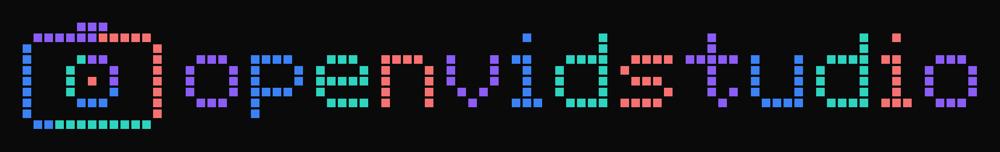
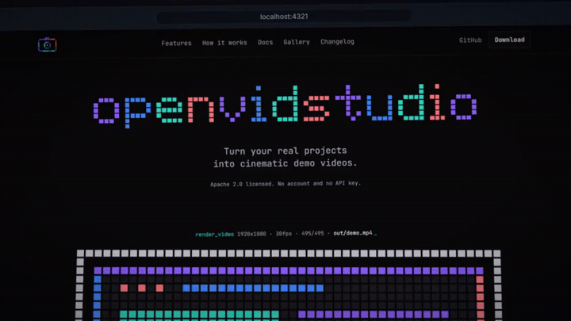

<div align="center">



# openvidstudio

**Your agent drives. Your product is the footage.**

Tell your AI coding agent to make a video of your project, and it does: a real browser
opens your real app, every frame is a capture of it, and the agent plans, narrates,
scores and renders the result on your machine.

[What it does](#what-it-does) · [Quick start](#quick-start) · [Director mode](#director-mode) · [Docs](#docs) · [Contributing](CONTRIBUTING.md)

[](https://github.com/AnayDhawan/openvidstudio/actions/workflows/ci.yml)
[](./LICENSE)

[](https://github.com/AnayDhawan/openvidstudio/stargazers)


</div>

---

<p align="center">
  
</p>

## What it does

You ask your agent for a video. openvidstudio gives it the tools to actually make one:

1. It **looks at your project**, works out how to start it, and reads your brand (colours, fonts, logo).
2. It **shows you a plan** before it writes or renders anything: the story, the shots, the script, the music. You approve it or change it.
3. It **captures your running app** with a real browser (or a desktop window, a phone, a terminal), so the pixels are yours.
4. It **narrates, scores and directs** the footage: a voice, an original soundtrack, camera moves, transitions.
5. It **renders locally** and hands you the mp4, a poster frame and a description with chapters and credits.

Claude Code, Cursor, or any other client that speaks the
[Model Context Protocol](https://modelcontextprotocol.io) can drive it, through
<!-- tools:base -->forty<!-- /tools --> tools (<!-- tools:higgsfield -->forty-one<!-- /tools --> with the optional Higgsfield tier).

### Why not just record the screen?

A screen recording shows what happened once. A directed video shows what matters. And the
usual alternatives each cost something: a timeline editor costs an afternoon, stock b-roll
shows a product that is not yours, and an AI video generator invents a product that does not exist.

openvidstudio sits in between. Nothing on screen is generated. It is your app, captured live,
then directed.

### What it does differently

- **Real product, real pixels.** The UI, the text and the layout are ground truth, not a mockup.
- **Your agent drives.** No separate app and no keyframing by hand.
- **Directed, not recorded.** Push-ins, depth, a cursor that arcs and settles, transitions that
  hide the cut, and depth of field that is off by default so it never smears the text you are showing.
- **Music that does not tick.** `compose_score` writes an original score for the video's arc, with
  an exact beat grid and no drums by default (evenly repeated hits sound like a ticking clock
  under a voiceover), and `finalize_video` warns if a track still ticks. `find_music_bed` searches
  two public-domain catalogs (about 9,400 tracks) when you want a real track. No attribution
  line, no content ID claim.
- **Not only web apps.** A desktop window, an Android device or iOS Simulator, and a terminal
  session are all capturable.
- **One edit costs one beat.** Beats render to their own cached segments, so fixing a caption in a
  five minute video re-renders ninety frames, not nine thousand.
- **Vertical when you need it.** A project can be 1080x1920 from the start, with a Reels export,
  instead of cropping a 16:9 video afterwards.

## Quick start

openvidstudio runs as an MCP server. Today the dependable way to run it is from a clone:

```bash
git clone https://github.com/AnayDhawan/openvidstudio.git
cd openvidstudio
pnpm install
pnpm build
```

Then add it to your MCP client's config (for Claude Code that is `.mcp.json`), using the path to
your clone, and restart the client:

```json
{
  "mcpServers": {
    "openvidstudio": {
      "command": "node",
      "args": ["/path/to/openvidstudio/packages/mcp-server/dist/stdio.js"]
    }
  }
}
```

<!-- tools:Base -->Forty<!-- /tools --> tools should appear. If they do not, run `preflight`; it checks your machine and
names the fix for your platform.

> **About npm.** `npx -y @openvidstudio/mcp-server` installs version 0.1.0 from September, which
> has about 27 tools and none of director mode. Publishing the current version is blocked for
> now, so use the clone above. This note goes away when the package is current.

Then paste this to your agent, from inside the repo you want a video of:

```
make a demo video of this project with openvidstudio.

handle it end to end. work out what this project is and how to start it, get it
running, and use its own brand rather than your defaults. ask me anything you
need along the way, one question at a time, and show me the result when it is
done.
```

That is all you do. You do not have to know the port, read the tool list or put the steps in
order. The agent checks the machine, reads your palette and fonts, asks what the video should
cover, and shows you the whole plan before anything is written. Say yes and it captures, renders
and hands you the mp4.

### What you need

| What | Minimum | Needed for | Blocking |
| --- | --- | --- | --- |
| Node.js | 20 | Runs the server | yes |
| pnpm | 9 | Building from a clone | yes |
| ffmpeg | 4.0 | Sound effects, audio checks, pulling frames back out of a render | yes |
| Playwright | 1.48 | Resolvable inside the project the video is built in | yes |
| Chromium | whatever `playwright install` pulls | The browser capture actually drives | yes |
| Your app | running, reachable | Capture points at a real URL | yes |
| edge-tts | any current, Python 3.8+ | Narration | no |
| numpy, scipy, soundfile, pyloudnorm, matplotlib | any current, Python 3.8+ | `compose_score`, the original-score tool | no |

`preflight` checks every row. Only the Node version is enforced numerically; the rest are presence
checks.

```bash
# Windows. Reopen the terminal after installing ffmpeg, winget only puts it on PATH for new shells.
winget install --id Gyan.FFmpeg -e
npm install playwright && npx playwright install chromium
pip install edge-tts
pip install numpy scipy soundfile pyloudnorm matplotlib   # only for compose_score

# macOS
brew install ffmpeg
npm install playwright && npx playwright install chromium
pip install edge-tts

# Debian or Ubuntu
sudo apt update && sudo apt install -y ffmpeg
npm install playwright && npx playwright install chromium
pip install edge-tts
```

Remotion normally downloads its own Chromium build the first time it renders, separate from the
Playwright one above, which fails with no network. Set `render.browserExecutable` in
`openvidstudio.config.json` to the path `preflight`'s `chromium` check reports, and `render_video`
reuses that browser instead.

### Long renders and client timeouts

A full render can take many minutes, and an MCP client's own timeout (often 60 to 120 seconds) can
end the call long before the render does. Pass `async: true` to `render_video`: it starts the render
in the background and returns a job id, and `job_status` reports progress until the result is ready.
`render_stills`, `validate_scenes` with `render: true` and `compose_score` take tens of seconds to a
couple of minutes; if your client cuts them off, raise its tool timeout rather than retrying, since
a retry starts the work again. `plan_production` measures this machine's real render speed, so its
estimate is the number to plan with.

## Director mode

For a launch video, a trailer, or anything that should look made rather than assembled, pick the
**peak** or **mid** creative level when the agent plans the production. It then works like a
director instead of filling in templates:

1. **A brief first.** The logline, the audience, the one feeling the video should leave, a story
   device chosen for this product, an arc with stakes, the design rationale and the music plan. It
   marks every shot as real or constructed. Nothing is written or rendered until you approve it.
2. **A design system as code.** Palette roles, a motif lifted from your brand, type and motion live
   in one file that scenes and validators both read.
3. **Music first.** An original score is composed to the brief's sections and impact points, and
   every cut lands on a downbeat. The agent cannot listen, so the tool reports numbers instead:
   band balance, clicks, a ticking check, loudness per section.
4. **Scenes written, not templated.** The agent builds them from core's primitives and writes a new
   component when the brief's motif needs one.
5. **A review loop before any full render.** `render_stills` renders several frames per beat, tiles
   them into one labelled contact grid, and returns the numbers (cropping, text size, reading
   time, contrast, safe area, dead frames). Look, fix, repeat, until the rubric in
   [CREATIVE.md](packages/docs/CREATIVE.md) passes.
6. **Facts, not memory.** Every tool's result is recorded and merged into `facts.json`. A number
   shown on screen comes from there or from a capture.
7. **Final assembly.** `finalize_video` sets the loudness (-14 LUFS), writes a poster and a
   size-capped share copy, and writes a description with chapters, credits and a disclosure of any
   constructed sample content.

The three production modes are **peak** (full creative liberty), **mid** (strong defaults, mostly
authored scenes) and **literal** (exactly what you specified, templates welcome). The agent-facing
process is the `openvidstudio-director` skill, and the craft is written down in
[CREATIVE.md](packages/docs/CREATIVE.md).

## The tools

| Area | What it does | Key tools |
| --- | --- | --- |
| **Project setup** | Scaffolds the project, checks the machine, plans the production | `init_project` · `preflight` · `plan_production` |
| **Beats** | Plans, validates and commits the script-and-shot skeleton every render is built from | `plan_beats` · `validate_beats` · `write_beats_file` |
| **Capture** | Browser, desktop, mobile and terminal capture of the real running app, zoom-compensated; a page can be split into depth layers | `capture_screenshot` · `capture_screen_recording` · `capture_desktop` · `capture_mobile` · `capture_terminal` |
| **Shot planning** | Ranks what the video should show from the repo's own emphasis | `plan_shots` |
| **Brief and design** | The creative brief written before any beat, and the design system as code | `write_brief` |
| **Scenes** | Hand-built scenes from core's primitives, or ten templates for literal briefs | `scaffold_scene` · `stitch_composition` |
| **Review loop** | Several real frames per beat in one contact grid, plus numeric findings | `render_stills` · `validate_scenes` |
| **Narration** | One paced clip per beat, sized to fit without sounding stretched | `generate_narration` |
| **Music and sound** | An original score, a real CC0 track, or the built-in pack | `compose_score` · `plan_music_cues` · `find_music_bed` · `import_music_bed` · `plan_sound_effects` |
| **Render** | Draft or full quality, incremental, beat by beat | `render_video` · `contact_sheet` |
| **Final assembly** | Loudness, a poster, a share copy, a description | `finalize_video` · `write_description` · `collect_facts` |
| **QC and diffing** | Pulls frames out, diffs against the last accepted render, flags docs drift | `qc_extract_frames` · `diff_beats` · `visual_regression` · `docs_drift` · `release_diff` |
| **Export** | A README GIF, docs screenshots, store frames, a Reels file, or a 9:16 cut | `export_rendition` · `reformat_vertical` |
| **Brand** | Reads your repo's palette, fonts and logo | `extract_brand` |
| **B-roll (optional)** | Higgsfield atmosphere shots for what a screen cannot produce, never product UI | `import_higgsfield_clip` |

[TOOLS.md](packages/docs/TOOLS.md) lists every tool with a one-line purpose, generated from the
server's own registry.

### The capture engine on its own

[`packages/capture`](./packages/capture) is zoom-compensated browser capture, interaction replay
and the desktop, mobile and terminal backends, with no dependency on Remotion, React or the video
pipeline. It is built to be used alone, if you want trustworthy captures of your app and are not
making a video. It is not on npm yet.

## Status

The pipeline runs end to end. An agent can go from a brief to a narrated mp4 without hand-writing
Remotion, and the director-mode run on a sample app passed 40 of 41 automated checks. Here is
where it is still rough:

- **The templates are plain.** They are structurally correct, so a first render looks right
  rather than good. Director mode is how you get past that, and the independent review of our
  own sample video scored its craft 2 out of 5 before the cinematic camera work. That work has
  landed; we have not yet measured it the same way.
- **npm is behind.** See the note under Quick start.
- **Lesson videos are not built yet.** We are working on a mode for short STEM explainers
  (script first, voiceover led, vertical). It is tracked in
  [#107](https://github.com/AnayDhawan/openvidstudio/issues/107) and does not work today.

## Docs

Start with [PLANNING.md](packages/docs/PLANNING.md) for the guided intake flow, then
[OVERVIEW.md](packages/docs/OVERVIEW.md) for the shape of the pipeline.
[PIPELINE.md](packages/docs/PIPELINE.md), [STYLE.md](packages/docs/STYLE.md),
[CAPTURE.md](packages/docs/CAPTURE.md) and [SCRIPT.md](packages/docs/SCRIPT.md) cover the steps and
the rules that are enforced rather than suggested. [CREATIVE.md](packages/docs/CREATIVE.md) is the
craft of directing, [API.md](packages/docs/API.md) is every core primitive with a rendered still,
and [NARRATION.md](packages/docs/NARRATION.md), [PRESETS.md](packages/docs/PRESETS.md) and
[HIGGSFIELD.md](packages/docs/HIGGSFIELD.md) cover the rest.

Both this repo and every scaffolded project also ship the official Remotion agent-skills bundle for
Claude Code, Cursor, Windsurf, OpenCode and GitHub Copilot, so whichever agent writes your scenes
has real Remotion knowledge to work from.

## Tech stack

| Area | Choice |
| --- | --- |
| Video engine | [Remotion](https://www.remotion.dev) (its own license, see below) |
| Capture | [Playwright](https://playwright.dev), ffmpeg |
| Agent interface | [Model Context Protocol](https://modelcontextprotocol.io) (`@openvidstudio/mcp-server`) |
| Narration | edge-tts |
| Language | TypeScript |
| Package manager | pnpm workspaces |
| CI | GitHub Actions |

## Folder structure

```
openvidstudio/
├── packages/
│   ├── capture/        # browser, desktop, mobile and terminal capture, no Remotion needed
│   ├── core/           # Remotion building blocks: camera, scenes, transitions, sound
│   ├── mcp-server/     # @openvidstudio/mcp-server: the <!-- tools:base:digits -->40<!-- /tools -->-<!-- tools:higgsfield:digits -->41<!-- /tools --> MCP tools an agent calls
│   └── docs/           # PLANNING · OVERVIEW · PIPELINE · STYLE · CREATIVE · CAPTURE · SCRIPT · API · NARRATION · TOOLS
├── templates/
│   └── default/        # the project init_project creates
├── evals/              # the director-mode eval: a sample app, a task, a scorer
├── brand/              # logo, wordmark, demo gif
└── .github/workflows/  # ci.yml, labeler.yml, stale.yml
```

## Contributing

This project is built mostly by a couple of students, and contributions of every size are welcome:
a typo, a bug report with good steps, a scene template, a capture backend, a guide for the agent you
use. You do not need to know Remotion or video to help. Start with [CONTRIBUTING.md](CONTRIBUTING.md),
look for [`good first issue`](https://github.com/AnayDhawan/openvidstudio/labels/good%20first%20issue),
and please follow our [Code of Conduct](CODE_OF_CONDUCT.md). Security issues: see
[SECURITY.md](SECURITY.md).

## License

openvidstudio itself is [Apache-2.0](./LICENSE): free for individuals and companies of any size,
including this repo's own code, the MCP tools and the capture package.

It renders through [Remotion](https://www.remotion.dev), which is under Remotion's own license, not
Apache-2.0. Remotion is free to render with if you are an individual, a non-profit, evaluating it, or
a for-profit company with up to 3 employees. A larger for-profit company needs a paid Remotion
Company License ([remotion.pro](https://www.remotion.pro/license)) to render with openvidstudio, the
same as it would to use Remotion directly. openvidstudio does not check for this; it is between you
and Remotion.
