# API.md: everything `@openvidstudio/core` exports

Written because the alternative is reading the library source. If you are an agent
about to write a scene, this file has every prop you need and you should not have to
open `packages/core/src`.

These are **building blocks**, not a template. At peak and mid creative level the agent is
expected to compose scenes from them against the video's own `design.ts`, and to write its
own component when the brief's motif needs something the library does not have. Every
primitive below has a still, rendered for real by `scripts/build-api-gallery.mjs`. The MCP
tools are listed in [TOOLS.md](TOOLS.md).

Import everything from the package root:

```tsx
import { CinematicScene, Layer, TerminalReplay, E, color } from "@openvidstudio/core";
```

---

## Scene wrapper

### `CinematicScene`

Wraps every scene. Grain, vignette and colour grade are always on, and the camera rig
lives inside it. Nothing renders outside one.

| Prop | Type | Default | Notes |
|---|---|---|---|
| `camera` | `CamKeyframe[]` | required | At least two, or nothing moves |
| `stageWidth` | `number` | composition width | 1920 in 16:9, 1080 in a 9:16 reel. Camera x/y are in stage px, so the centre is 960,540 or 540,960 |
| `stageHeight` | `number` | composition height | |
| `variant` | `"dark" \| "light"` | `"dark"` | |
| `grain` | `number` | `0.05` | |
| `vignette` | `number` | `0.32` | |
| `overlay` | `ReactNode` | | Screen space, not camera transformed. Captions and title cards go here |
| `children` | `ReactNode` | required | |

**The overlay is not optional knowledge.** Anything inside `children` moves with the
camera, so a caption placed there drifts off screen as the shot pushes in. Captions,
title cards and dips belong in `overlay`.

---

## Camera

### `CamKeyframe`

```ts
type CamKeyframe = {
  frame: number;
  x: number;        // focal point on the stage, lands at frame centre
  y: number;
  scale: number;    // 1 = stage px equals output px, 1.6 = 160% close up
  rotX?: number;
  rotY?: number;
  rotZ?: number;
  easing?: (t: number) => number;  // easing INTO this keyframe
};
```

**The one thing that catches everyone.** The visible area is the stage divided by
`scale`. At `scale: 1.4` only 1371x771 of a 1920x1080 stage is on screen, so content
laid out at full stage width is cropped at the frame edge, and the render does not
warn. The binding number is the scene's **highest** scale, not its first.

Rules of thumb:

- Real captures with text: 1.05 to 1.6. STYLE.md requires the camera to sit inside the UI
  rather than showing a flat full-screen grab, but past 1.6 the product text goes soft.
  Captures without text to read can push further.
- Constructed panels: 1.04 to 1.15. They are already built at stage size, so they
  need a gentle push, not a zoom.
- Run `validate_scenes` and it will tell you which scenes are cropping. That is a read of
  the source. Pass `render: true` (after `stitch_composition`) to measure the real rendered
  frames instead: cropped text, text below the design system's minimum size, on-screen text
  that takes longer to read than the beat lasts (3 words/sec), and beats that never change.

### `Layer`

| Prop | Type | Default | Notes |
|---|---|---|---|
| `depth` | `number` | `0` | Distance from the focal plane. `0` is the focal plane, positive is behind it, negative is in front |
| `maxBlur` | `number` | `10` | Blur in px at `|depth|` 1, scaled by `|depth|`. `0` turns the depth blur off |
| `style` | `CSSProperties` | | |

Depth is a place in space. A layer is moved back (or forward) by `depth * 170` px and scaled
about the stage centre so it looks the same size, so with the camera still on the stage centre
every depth shows the same picture. When the camera pans, the rig's perspective does the rest:
a layer at depth 1 moves 0.89 as far as the focal plane, depth 2 about 0.80, and a layer at
depth -1 moves 1.14 times as far. Depth also orders layers: one behind stays behind however the
JSX is ordered. A Layer has to be a direct child of the rig's stage (a plain wrapper `div`
in between flattens the depth).

One focal plane per shot. Blur on a layer softens any text in it, so pass `maxBlur={0}` to a
layer that carries text.

### `CameraRig`, `useCamera`

`CinematicScene` sets these up for you. Reach for them only when building a scene
that needs the camera state directly.

`CameraRig` also takes `viewportWidth` and `viewportHeight`, the size of the window the camera
looks through (default: the composition's size). A rig nested in a smaller box, such as
`DirectedShot`, passes that box's size. `resolveCamera(keyframes, frame)` returns the camera
state the rig renders at a frame, for code that needs to know where the camera is without
rendering.

`useCamera()` returns the camera state plus `stageWidth` and `stageHeight` (type `CameraInfo`), or
`null` outside a rig. `projectToScreen(camera, viewportWidth, viewportHeight, x, y)` returns where
a stage point lands on screen, through the same rotation, scale and perspective the rig applies.

### `DirectedShot`

A nested camera rig that turns a flat capture into a directed move: a push-in on one point,
an optional tilt, optional depth of field and motion blur, handheld sway, and a cursor, all in
the capture's own pixel space. It owns its own `CameraRig`, so it sits inside a `CinematicScene`
(or anywhere) without touching that scene's camera.

```tsx
<DirectedShot
  src={staticFile("images/dashboard.png")}
  focus={{ x: 1560, y: 280 }}
  push={1.9}
  tilt={{ y: -4, x: 2 }}
  move={{ from: 0, to: 70 }}
  cursor={{ path: [{ frame: 0, x: 900, y: 600 }, { frame: 55, x: 1500, y: 300 }], clicks: [60] }}
/>
```

| Prop | Type | Default | Notes |
|---|---|---|---|
| `src` | `string` | | Image URL, usually `staticFile("images/<beat>.png")`. Use `children` for anything else |
| `focus` | `{ x, y }` | the middle | The point in the capture, in capture pixels, the move pushes into |
| `push` | `number` | `1.4` | End zoom relative to fitting the whole capture in the box. `1` holds the full frame. Keep it at or under `1.6` when the capture has text |
| `shot` | `ShotName` | | A named move (see Shots below). It supplies zoom, start and end position, tilt, easing and length; `push`, `tilt` and `move` given explicitly win |
| `tilt` | `{ x?, y?, z? }` | | Rotation in degrees at the end of the move. 2 to 6 reads as depth |
| `move` | `{ from?, to?, easing? }` | `0` to `90` | Frames, local to the scene. Defaults to `E.cinematic`; a `shot` sets its own length |
| `depthOfField` | `number` | `0` | Blur in px away from the focal point. Off by default: blur smears product text. Never use it on a shot whose text has to be read |
| `protect` | `{ x, y, width, height }[]` | | Regions of the capture, in capture pixels, that stay sharp under `depthOfField`. Hard edged, and they follow the camera through a push and a tilt |
| `rackTo` | `{ x, y }` | | Rack focus: the sharp region slides from `focus` to this point, in capture pixels, across the move |
| `blur` | `boolean \| { shutterAngle?, samples? }` | on for `whip`, else off | Motion blur while the camera moves, and only then. `true` is a 180 degree shutter with 8 samples. Costs `samples` times the render work for those frames |
| `handheld` | `number` | `0` | Handheld sway, the largest drift in px at 1080p. 3 to 8 reads as a person holding the camera |
| `shake` | `number[]` | | Local frames of impacts. The shot jolts 12px (at 1080p) on each and settles within about 24 frames |
| `cursor` | `{ path, clicks? }` | | A `CursorActor` path and click frames, in capture pixels. The cursor sits above the blur layers and is never blurred |
| `captureWidth`, `captureHeight` | `number` | `1920`, `1080` | The capture's natural size |
| `width`, `height` | `number` | the composition | The box the shot fills |

The move starts on the whole capture and ends pushed in on `focus`. The end centre is clamped
so the camera never leaves the capture (empty stage reads as a mistake). Sway and shake move the
whole shot, cursor included, and the shot is scaled up slightly so the shift never shows an edge;
with neither set, nothing extra is rendered.

`directedKeyframes({ W, H, captureWidth, captureHeight, focus?, push?, tilt?, move?, shot? })`
returns the two camera keyframes a `DirectedShot` renders with, so `resolveCamera` can read the
camera at any frame without mounting the component.

| Start of the move | End of the move |
|---|---|
| 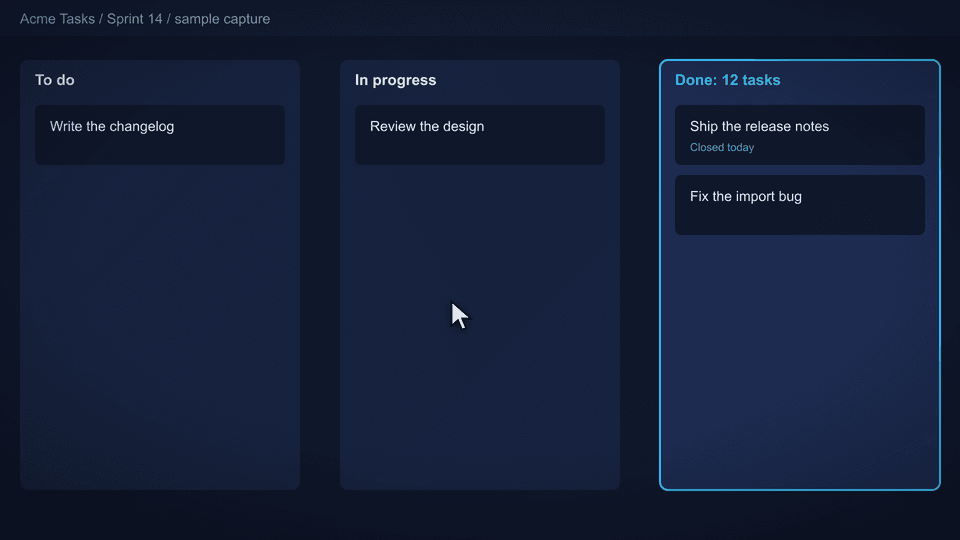 | 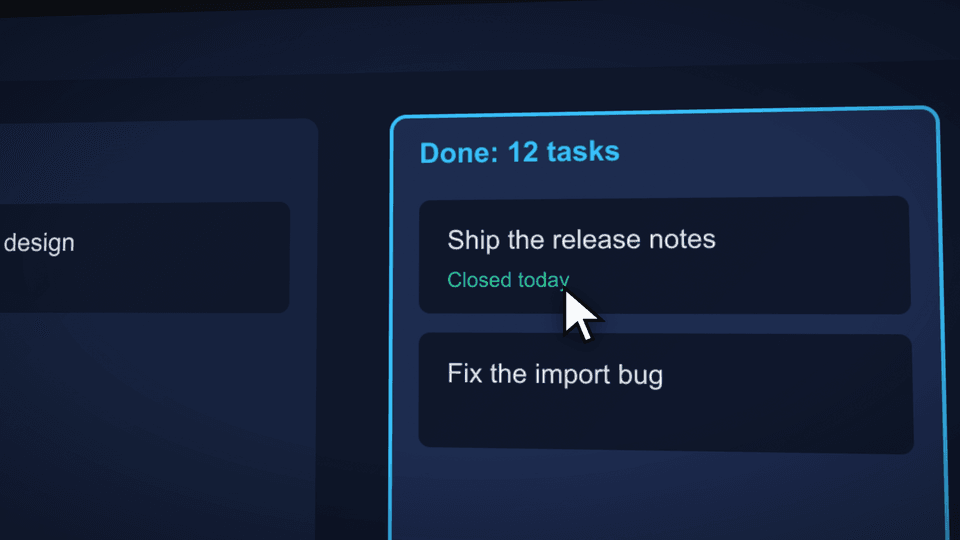 |

### Shots: `resolveShot`, `SHOT_NAMES`

`<DirectedShot shot="whip" />` applies a named move. Each is plain data from a pure function, so a
scene can read it too: `resolveShot(name, { focus?, push?, captureWidth?, captureHeight? })` returns
`{ startScale, endScale, startFocus, endFocus, startTilt, tilt, easing, moveFrames, blur }`
(zoom relative to fitting the whole capture, camera positions in capture pixels, tilt in degrees).
`push` overrides the preset's zoom.

| Shot | The move | Zoom | Frames |
|---|---|---|---|
| `pushIn` | From the whole capture in to the focus. The default workhorse | 1 to 1.4 | 90 |
| `pullOut` | Starts close on the focus and backs out to the whole capture, to reveal context | 1.5 to 1 | 90 |
| `pan` | Same zoom throughout; the camera slides sideways onto the focus with a slight yaw | 1.35 | 75 |
| `whip` | A fast slide in from the side, `E.whip` easing, motion blur on | 1.5 | 18 |
| `orbit` | The camera swings around the focus: `rotY` goes from -5 to +5 degrees | 1.15 to 1.35 | 120 |
| `dutch` | A push that rolls the horizon off level, 3.5 degrees | 1 to 1.35 | 90 |
| `hold` | The whole capture with a 2% creep so it is never dead. For action inside the frame: a cursor, typing | 1 to 1.02 | 60 |
| `drift` | Ambient: a long, small move toward the focus with a sub-degree wander in the tilt | 1 to 1.06 | 150 |

Each move, caught half way through (the dashboard capture, focus on the Done column):

| | | |
|---|---|---|
| 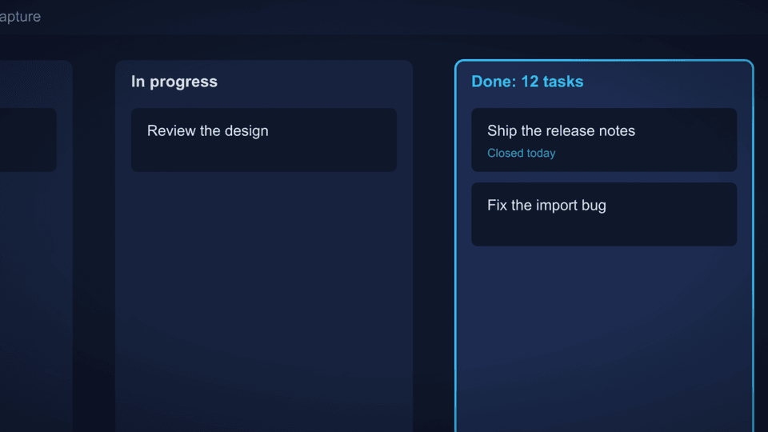 `pushIn` | 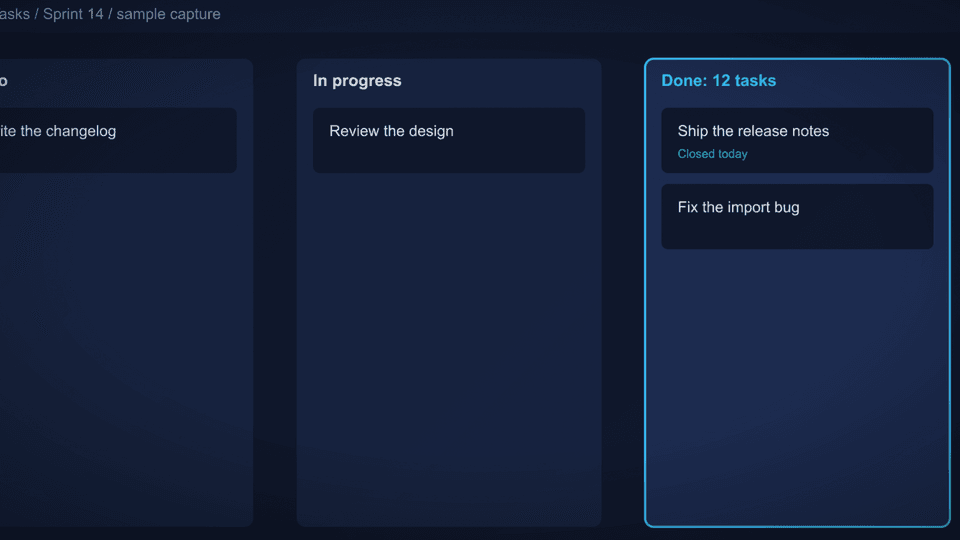 `pullOut` | 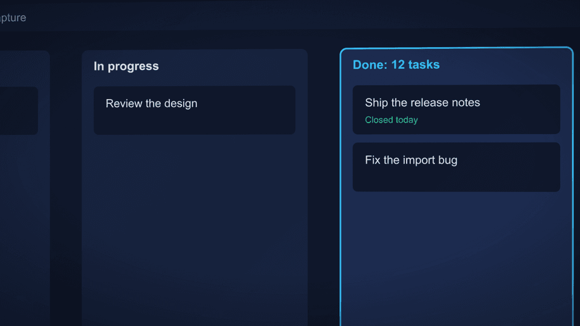 `pan` |
| 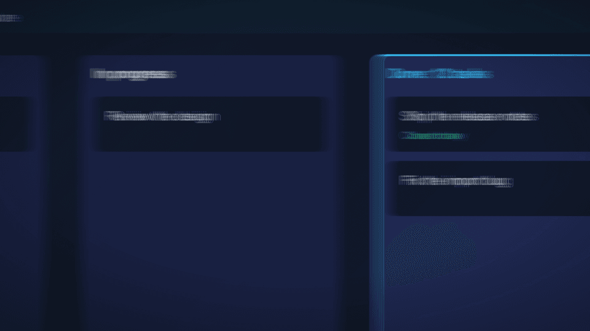 `whip` | 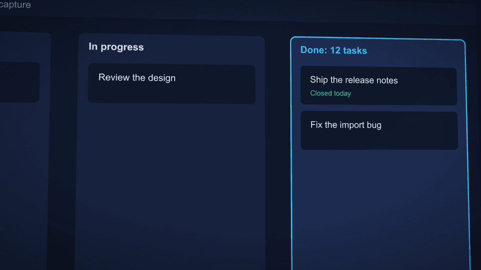 `orbit` | 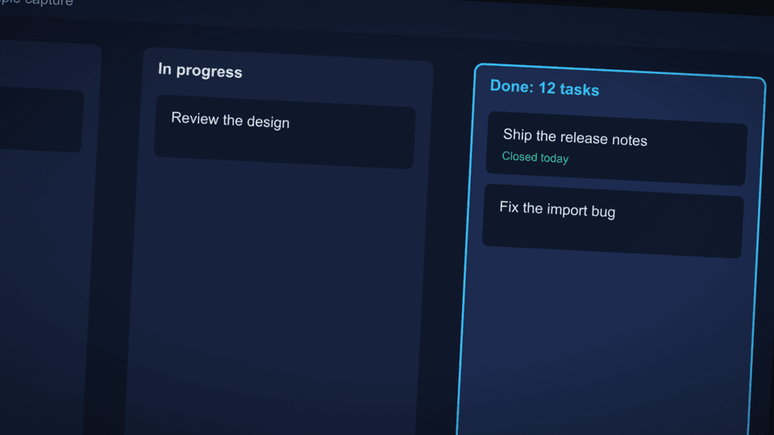 `dutch` |

### `LayeredShot`

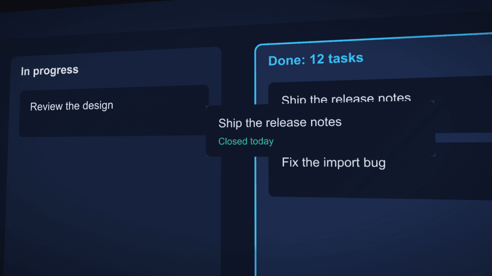

A `DirectedShot` whose picture is a stack of layers instead of one flat image: a background plus
the elements that float above it, each at its own depth, so a push and a tilt make them slide
against each other. At rest the stack composites to the same picture as the flat capture. Takes
every `DirectedShot` prop except `src` and `children`, plus:

| Prop | Type | Default | Notes |
|---|---|---|---|
| `manifest` | `{ width, height, background, layers }` | | The capture's size, the flat background URL and the layers |
| `background`, `layers` | `string`, `ShotLayer[]` | | Instead of `manifest`; give `captureWidth` and `captureHeight` too |
| `backgroundDepth` | `number` | `1` | Depth of the background plane, a notch behind the focal plane |
| `maxBlur` | `number` | `0` | Blur per unit of depth, in px. Off, because the layers are real UI |

```ts
type ShotLayer = { src: string; x: number; y: number; width: number; height: number; depth: number };
// x, y, width, height in capture pixels; depth > 0 is behind the focal plane, < 0 in front
```

### `MotionBlur`

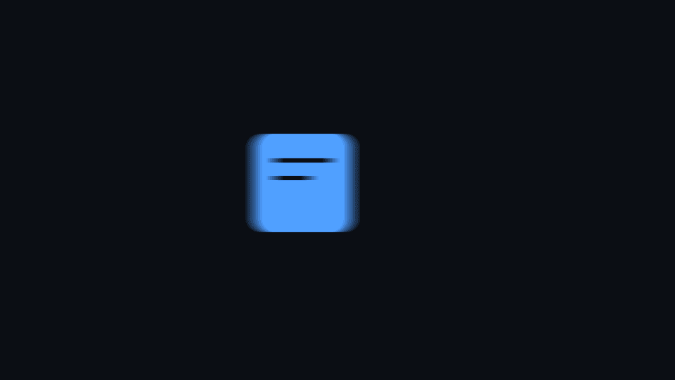

Wraps children in Remotion's `CameraMotionBlur`, but only for the frames of a window. Outside it the
children render directly, as if the wrapper were not there.

| Prop | Type | Default | Notes |
|---|---|---|---|
| `from` | `number` | `0` | First frame of the window, local to the scene |
| `to` | `number` | never | Last frame of the window, inclusive |
| `shutterAngle` | `number` | `180` | Degrees, 0 to 360. Larger smears more |
| `samples` | `number` | `8` | Sub-frame renders blended. More is smoother and slower |

### Handheld and impact shake

Small deterministic camera motion, as pure functions and hooks. `DirectedShot` uses them for its
`handheld` and `shake` props; use them directly to move anything else.

```ts
handheldOffset(frame, amount, seed = 1): { x, y, rot }       // px and degrees; |x|, |y| <= amount
useHandheld(amount, { holds?, seed?, ramp? }): { x, y, rot }  // scaled to the composition height
impactShake(frame, impactFrames, { amplitude = 12, decay = 8 }): { x, y, rot }
useImpactShake(impactFrames, { amplitude?, decay? }): { x, y, rot }
```

Sway is two unrelated sines per axis, so the path does not repeat. `holds` is a list of
`[from, to]` frame windows where `useHandheld` is exactly zero (the camera is set down while a
cursor clicks or a block of text is read), easing in and out over `ramp` frames (default 6).
Shake is exactly zero before an impact frame, at full `amplitude` on it, and below 5% of it
after `3 * decay` frames. All of it is a function of the frame, never `Math.random()`.

---

## Motion

### `E` and `SPRING`

```ts
E.cinematic  // default move: slow out, soft landing
E.whip       // aggressive, for cuts and fast pans
E.drift      // gentle ambient motion inside a shot
E.snap       // snappy UI reaction, button press, blip reveal
E.sine       // symmetric ease in and out along a sine: calm, even, no hard push
E.expo       // symmetric ease in and out along an exponential: still at the ends, fast through the middle

SPRING.soft  SPRING.pop  SPRING.heavy
```

**Linear easing fails QC.** There is no linear preset on purpose.

### `tween`, `pop`, `jitter`, `staggerDelay`

```ts
tween(frame, [fromFrame, toFrame], [fromValue, toValue], E.cinematic): number
pop(frame, fps, atFrame): number          // spring entrance scalar
jitter(seed, n): number                   // deterministic 0..1, same every render
staggerDelay(index, step = 3): number     // 3 frames at 30fps is 100ms
```

`jitter` is deterministic. Never use `Math.random()` in a scene: every frame renders
in a separate process and random values differ per frame, which shows up as flicker.

---

## Text

### `TitleSlam`

| Prop | Type | Default |
|---|---|---|
| `text` | `string` | required |
| `at` | `number` | required |
| `fontSize` | `number` | `120` |
| `color` | `string` | `color.textPrimary` |
| `glowColor` | `string` | |
| `align` | `"center" \| "left"` | `"center"` |
| `sfx` | `boolean` | `false` |

Per word entrance. Renders nothing before `at`. `sfx` adds a blip per word; it is off by
default because a blip every few frames sounds like a ticking clock under a title.

### `Caption`

| Prop | Type | Default |
|---|---|---|
| `text` | `string` | required |
| `at` | `number` | required |
| `out` | `number` | |
| `fontSize` | `number` | `34` |
| `position` | `"bottom" \| "top" \| "left" \| "right" \| "auto"` | `"bottom"` |
| `avoid` | `{ x, y, width, height }` | |

Sits 84px from the chosen edge. Put it in `overlay`, not `children`. Vary `position` from scene to
scene; the same spot in every scene covers the same part of the product every time.

- `"auto"` with `avoid` (the part of the frame that carries the product, in composition pixels)
  takes the edge with the most free room beside that rect, counting only edges where the card fits.
  Ties go bottom, top, right, left. With no `avoid` it stays at the bottom.
- The reveal is always finished within 8 frames of `at`, however many words there are: the
  per-word stagger shrinks as the caption grows (2 frames for short ones), so no frame a reviewer
  lands on shows a half-typed line.
- The card is at most `min(1400, 0.9 * composition width)` wide, so it fits a 1080 wide
  vertical frame. `"left"` and `"right"` use a column of `min(640, 0.34 * width)`.
- `captionLayout(position, avoid, width, height, fontSize)` returns `{ side, maxWidth }`, the
  rule above as a function.

---

## Panels

### `BrowserFrame`

| Prop | Type | Default |
|---|---|---|
| `url` | `string` | required |
| `width` | `number` | `1360` |
| `height` | `number` | `850` |
| `dark` | `boolean` | `true` |
| `children` | `ReactNode` | required |

Chrome bar is 56px, so `height` must be the capture height plus 56 or the page is
letterboxed. `scaffold_scene` computes this from the real PNG for you.

Screenshots may only appear inside a `BrowserFrame`. Recordings and AI clips must
not: wrapping generated footage in browser chrome makes it look like a captured
page, which STYLE.md's provenance rule forbids.

### `CodePanel`

| Prop | Type | Default |
|---|---|---|
| `title` | `string` | required |
| `lines` | `CodeLine[]` | required |
| `width` | `number` | `860` |
| `height` | `number` | `640` |
| `fontSize` | `number` | `22` |
| `scroll` | `number` | `0` | px translateY, drive with a tween |
| `highlight` | `number[]` | `[]` | 0-based line indexes |

```ts
type Token = { t: string; c?: "kw" | "str" | "fn" | "cm" | "num" | "plain" };
type CodeLine = Token[];
```

```tsx
lines={[
  [{ t: "{", c: "plain" }],
  [{ t: '  "name"', c: "str" }, { t: ": ", c: "plain" }, { t: '"value"', c: "str" }],
]}
```

### `ChecklistPanel`

| Prop | Type | Default |
|---|---|---|
| `title` | `string` | `"Community Standards"` |
| `items` | `ChecklistItem[]` | required |
| `width` | `number` | `760` |
| `fontSize` | `number` | `27` |
| `sfx` | `boolean` | `true` |

```ts
type ChecklistItem = { label: string; flipAt?: number };  // omit flipAt to stay unchecked
```

`flipAt` is an absolute scene frame.

### `TerminalReplay`

| Prop | Type | Default |
|---|---|---|
| `steps` | `TermStep[]` | required |
| `title` | `string` | `"Project"` |
| `width` | `number` | `1280` |
| `fontSize` | `number` | `26` |
| `cps` | `number` | `16` | characters per second |
| `sfx` | `boolean` | `true` |
| `trailingPrompt` | `boolean` | `true` |

```ts
type TermLine = { text: string; color?: string; glow?: boolean; bold?: boolean };
type TermStep =
  | { type: "cmd"; text: string }
  | { type: "out"; lines: TermLine[]; stagger?: number; preDelay?: number }
  | { type: "pause"; frames: number };
```

Terminals are always this component, never a screen recording of a terminal.

`computeTerminalTimeline(steps, fps, cps)` returns `{ items, totalFrames }`, so camera
keyframes can land frame-exact on content events rather than being guessed.

### `CursorActor`

| Prop | Type | Default |
|---|---|---|
| `path` | `CursorKeyframe[]` | required |
| `clicks` | `number[]` | `[]` | frames where a click ring fires |
| `scale` | `number` | `1.6` |
| `sfx` | `boolean` | `true` |

```ts
type CursorKeyframe = { frame: number; x: number; y: number };
```

Coordinates are stage space. Movement is eased automatically; never linear. Each segment bows
sideways by up to 6% of its length (the side alternates from one segment to the next) and swings
2.5% of its length past the target before settling, so the cursor moves like a hand. Progress
along the segment still follows `E.cinematic`, and on a keyframe's own frame the cursor is exactly
on the keyframe, so a click ring lands on its target. `cursorPositionAt(path, frame)` returns the
position `CursorActor` draws at a frame.

### `RepoCta`

| Prop | Type | Default |
|---|---|---|
| `owner` | `string` | required |
| `name` | `string` | required |
| `description` | `string` | required |
| `chips` | `string[]` | required |
| `titleText` | `string` | required |
| `durationInFrames` | `number` | `270` |

A whole scene, not a panel. Do not wrap it in a `CinematicScene`; it brings its own.
No star action by default. Laid out from the composition size, so the card is centred in
1920x1080 and in a 1080x1920 reel.

---

## Sound

Synthesized by `scripts/gen-sfx.sh` with ffmpeg, except `typing-effect.mp3`, a
copyright-free recording, so a rendered video carries no third-party audio rights.
Regenerate the synthesized files with `bash scripts/gen-sfx.sh`.

| Component | Props | Use |
|---|---|---|
| `TypingSfx` | `charFrames`, `volume?` (1) | The typing recording, played across each typed run |
| `Click` | `at`, `volume?` | Cursor click |
| `Whoosh` | `at`, `volume?` | Camera move or cut |
| `Blip` | `at`, `volume?` (0.3) | UI reveal |
| `SuccessChime` | `at`, `volume?` (0.35) | Completion |
| `Bell` | `at`, `volume?` (0.3) | Heavier completion |
| `MusicBed` | `durationInFrames`, `volume?` (0.16) | Ambient bed, loops |

`TerminalReplay` emits its own typing sounds. Pass `sfx={false}` to silence it.

Narration is separate: `generate_narration` writes
`public/audio/vo/<beatId>.mp3` and `stitch_composition` picks it up.

---

## Music clock

The score's grid as scene-local frames, so a cut, a reveal or a glow can land on the music.
`stitch_composition` copies the bed's `<stem>.cues.json` next to the composition and mounts
`MusicClockProvider` with each beat's start frame; a scene just asks for its own beat.

```tsx
const clock = useMusicClock("reveal");   // the beat id, exactly as in beats.json
const hit = clock.at(8);                  // first downbeat of bar 8, as a frame local to this scene
const glow = clock.beatPulse();           // 1 on each beat, decaying to 0 before the next
if (clock.onDownbeat()) { /* a bar starts on this frame */ }
```

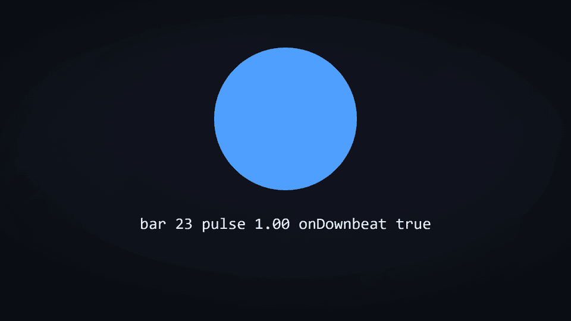
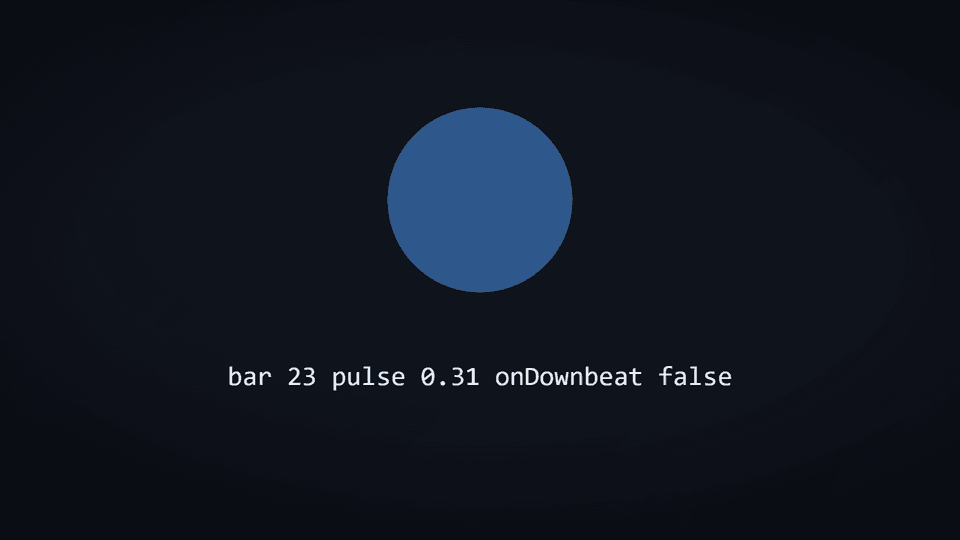

Bars count from 0 at the start of the track, in 4/4 (what `compose_score` writes), and the bed
is mounted at composition frame 0. `useMusicClock(beatId)` must be called inside that beat's
scene, because the pulse helpers read the scene's current frame.

| Member | Notes |
|---|---|
| `at(bar, beat?)` | Scene-local frame of that bar and beat (`beat` may be fractional: `at(8, 2.5)`). Rounded to the nearest frame; negative when it is before the scene starts |
| `position(frame)` | `{ bar, beat }` a scene-local frame falls in |
| `impact(label)` | Scene-local frame of the score's impact point with that label, or `null` |
| `sectionAt(frame)` | The section label a frame falls in, or `null` without sections |
| `beatPulse({ decay?, strongOnly? })` | 1 on a beat, decaying to 0 over `decay` (0.6) of a beat; `strongOnly` pulses on downbeats only |
| `onBeat()`, `onDownbeat()` | True on the frame a beat or a bar starts, using the same rounding as `at` |
| `available`, `bpm`, `framesPerBeat`, `framesPerBar` | `available` is false when the bed has no cues file; the clock then runs a 120 bpm grid so a scene still renders |

`createMusicClock({ cues, fps, sceneStartFrame, frame })` is the pure core, for tests.
`plan_beats` with `snapToBars` plans beat boundaries onto the same downbeats.

---

## Narration words

When each word of a beat's narration is said, for a scene that points at the word being spoken.
`generate_narration` (edge-tts engine) writes `public/audio/vo/<beatId>.words.json`, `stitch_composition`
copies it next to the composition and mounts it with `NarrationWordsProvider`. See NARRATION.md.

### `useNarrationWords(beatId)`

Call it inside the scene of beat `beatId`.

| Member | Type | Notes |
|---|---|---|
| `available` | `boolean` | False when the beat has no timings (another engine, or none generated) |
| `words` | `{ word, startMs, endMs }[]` | In the clip as written |
| `wordAt(frame?)` | `{ index, word, speaking } \| null` | The word being said at a scene-local frame (default: the current one), or in a pause the last one said (`speaking: false`). `null` before the first word |
| `frameOfWord(index)` | `number \| null` | The scene-local frame word `index` starts on, rounded to the nearest frame |

`createNarrationWords(words, fps, frame?)` is the same thing without Remotion, for tests.

---

## Look pass

`FilmGrain`, `Vignette`, `ColorGrade`, `LookPass`. `CinematicScene` applies these, so
reach for them only when compositing outside a scene.

---

## Tokens

```ts
color.bg0 color.bg1 color.panel color.panelBorder
color.textPrimary color.textSecondary
color.accent color.accentAlt color.success color.warn color.danger
color.lightBg color.lightCard color.lightShadow

font.ui    // "Inter"
font.mono  // "JetBrains Mono"

radius.window  // 12
radius.card    // 10
radius.pill    // 999

glow(color, strength = 1)       // returns { textShadow }
panelShadow(dark = true)        // returns a box-shadow string
```

Use tokens rather than literal hex, so a per-video theme can override them.

---

## Design system

### `defineDesignSystem(overrides?)`

Builds one video's `DesignSystem`: palette, type scale, layout grid, a signature
motif, a motion personality, a transition vocabulary and a texture pass. Call it
once in that video's own `src/videos/<name>/design.ts`:

```ts
export const design = defineDesignSystem({
  motif: "pixel-grid",
  motion: { cameraEnergy: "energetic" },
});
```

Anything omitted falls back to the current brand tokens (`color`/`font`, already
brand-applied if `extract_brand` ran) and STYLE.md's own defaults. The result is a
plain object, frozen at the point `design.ts` is imported, not a live binding: a
later `applyBrand` call never reaches into an already-built `DesignSystem`.

| Field | Type | Notes |
|---|---|---|
| `color`, `font` | tokens | Seeded from the current brand tokens |
| `typeScale` | `{ display, headline, body, mono: [min, max] }` | px |
| `grid` | `{ marginX, marginTop, marginBottom }` | px. Default 150 / 130 / 110 at 1920x1080; scaled to `stage` when one is passed (84 / 231 / 196 at 1080x1920). An explicit `grid` wins |
| `stage` (input only) | `{ width, height }` | The frame the video renders at, default 1920x1080. Pass `{ width: 1080, height: 1920 }` in a native vertical project. Not stored on the result |
| `motif` | `"pixel-grid" \| "rounded-soft" \| "geometric" \| "editorial" \| "void-spark"` | Default `"rounded-soft"`. `"void-spark"` is Supernova mode's |
| `motion` | `{ easing, staggerMs, cameraEnergy, cutRhythmSeconds }` | `easing` names an `E.*` preset by string, not a function reference, so the system stays JSON-serializable |
| `transitions` | `string[]` | Preference order, default `["cut", "whip", "fade", "push", "wipe", "light-leak"]` |
| `texture` | `{ grainOpacity, vignetteStrength }` | STYLE.md's default ranges |

### `contrastRatio(hexA, hexB)`

WCAG relative-luminance contrast ratio, 1 (no contrast) to 21 (black on white).
Reach for it directly when a bespoke scene picks a text colour against a
background the design system doesn't already pair.

Several primitives below take an optional `design?: DesignSystem` prop: pass
that video's own `design` export and they read palette, motif and motion from
it instead of the package's global tokens.

---

## Kinetic text

### `Words`

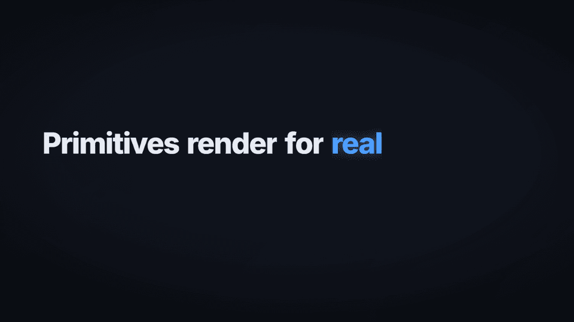

Per-word masked reveal. Never a plain opacity fade (STYLE.md): each word clips
in from below on its own stagger, and clips back out the same way if `out` is
set.

| Prop | Type | Default | Notes |
|---|---|---|---|
| `text` | `string` | required | Split on spaces, one reveal per word |
| `at` | `number` | required | Frame the first word starts |
| `out` | `number` | | Frame the exit starts. Omit to leave the line on screen |
| `size` | `number` | `72` | |
| `weight` | `number` | `800` | |
| `color` | `string` | `color.textPrimary` | |
| `accent` | `Record<number, string>` | `{}` | Word index to accent colour, for one word landing harder than the rest |
| `stagger` | `number` | | Frames between word starts. Explicit value always wins |
| `design` | `DesignSystem` | | Without `stagger`, reads `design.motion.staggerMs` at the composition's fps; with neither, falls back to 3 frames |
| `align` | `"left" \| "center" \| "right"` | `"left"` | |
| `font`, `tracking`, `lineHeight`, `maxWidth`, `glow`, `italic`, `style` | | | |

### `useTyped(text, at, cps?)`

Typewriter hook. Returns `{ visible, done, charFrames, end }`: the visible slice
of `text` at the current frame, plus the per-character reveal frames, so a
caller can drive `TypingSfx` off the exact same numbers the visible text uses.
`cps` defaults to 22 characters per second.

### `Caret`

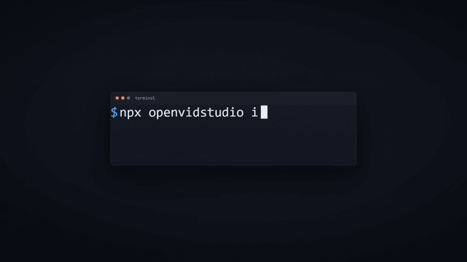

| Prop | Type | Default |
|---|---|---|
| `h` | `number` | `40` |
| `color` | `string` | `color.textPrimary` |
| `blink` | `boolean` | `true` |

Blinking text caret, sized to a line height. Pair with `useTyped` for a typed line.

---

## Pixel-grid family

### `DotText`


5x7 dot-matrix text, built pixel by pixel rather than drawn with a font file.

| Prop | Type | Default | Notes |
|---|---|---|---|
| `text` | `string` | required | Uppercased; unsupported characters render as a blank cell |
| `at` | `number` | required | |
| `px` | `number` | `14` | px per cell |
| `colors` | `string[] \| "cycle"` | `"cycle"` | `"cycle"` uses the token/design accent, accentAlt, success, warn four |
| `solid` | `string` | | Overrides `colors` with one flat colour for every pixel |
| `build` | `"scatter" \| "wipe" \| "none"` | `"wipe"` | |
| `out` | `number` | | Frame the exit starts |
| `glow` | `number` | `0.6` | |
| `seed` | `number` | `3` | |

### `PixelLogo`


Assembles a pixel-grid logo from its own rect shapes, each flying in from a ring
around the mark (`build="scatter"`) or rendered flat (`build="none"`). The ring's
centre and spread come from the shapes' own bounding box, so this works for any
pixel-grid logo.

| Prop | Type | Default | Notes |
|---|---|---|---|
| `shapes` | `PixelShape[]` | required | `{ x, y, width, height, color }`, the same shape `extract_brand` already produces for an SVG rect |
| `at` | `number` | required | |
| `scale` | `number` | `1` | Output px per source (viewBox) unit |
| `build` | `"scatter" \| "none"` | `"scatter"` | |
| `glow` | `number` | `0.9` | |
| `out` | `number` | | Frame the exit starts |
| `seed` | `number` | `5` | |
| `style` | `CSSProperties` | | |

### `PixelWipe`

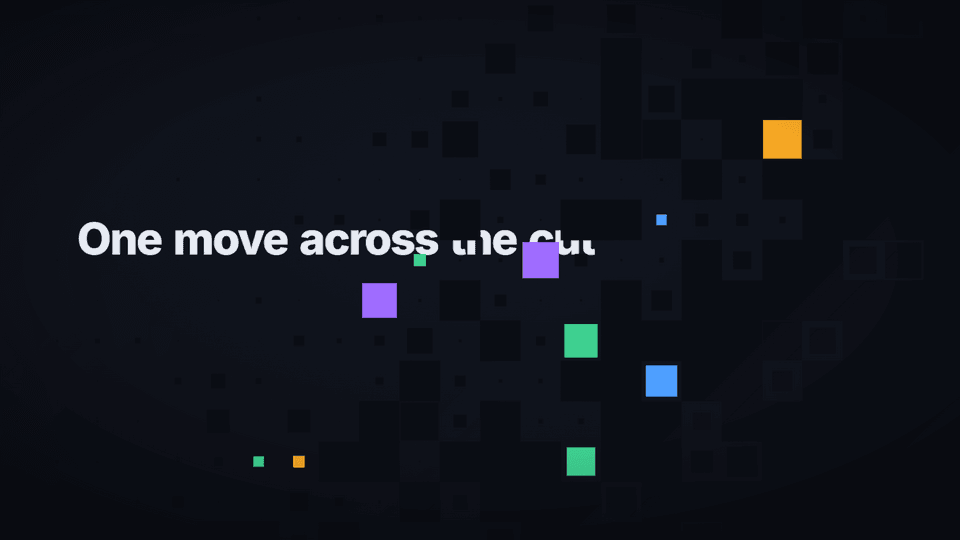

Transition pair, pixel-grid's natural home but usable standalone. Call both
ends of a cut with the same `cell`/`seed` so the out and the following in read
as one continuous move across the cut.

| Prop | Type | Default | Notes |
|---|---|---|---|
| `mode` | `"in" \| "out"` | required | `"in"`: starts fully covered, clears. `"out"`: finishes covered at the scene's last frame |
| `at` | `number` | | Defaults to frame 0 (`in`) or `durationInFrames - dur - 1` (`out`) |
| `dur` | `number` | `12` | |
| `cell` | `number` | `60` | |
| `seed` | `number` | `1` | |
| `bg`, `tint` | | | Default to `design`'s colours if `design` is passed, else the package tokens |
| `design` | `DesignSystem` | | Optional; only informs the default tint and background |

---

## Backgrounds and transitions

| Component | Props | Notes |
|---|---|---|
| `Atmosphere` | `intensity?` (1), `colors?`, `seed?` (2) | Soft drifting radial colour fields behind everything, one blob per colour |
| `DotGrid` | `gap?` (36), `color?` (`#ffffff`), `opacity?` (0.05), `w?`, `h?` (composition size) | Faint texture pass behind a constructed (non-capture) panel. Covers the whole frame by default, 1080x1920 included |
| `Flash` | `at`, `color?` (`#ffffff`), `strength?` (0.55), `dur?` (10) | Brief exposure flash on a hard hit |
| `Black` | `from`, `to?` | Holds solid black. Omit `to` to hold forever |
| `Letterbox` | `amount?` (1) | Bars for a cinematic moment. `amount` scales the bar height, 1 = 64/1080 of the frame height (64px at 1080, about 114px at 1920 tall) |
| `TransitionOverlay` | `type` (`"fade"`, `"whip"`, `"push"`, `"wipe"`, `"light-leak"`), `length?` | A transition drawn over a hard cut, in the colour tokens. Mount it in a `Sequence` that starts `length / 2` frames before the cut (`layout="none"`): it peaks on the cut frame and is clear on its first and last frames. `length` is its total frames and defaults to the Sequence's. `stitch_composition` does this for every beat whose `transition` is not `"cut"`, so a scene rarely mounts one by hand |

| | |
|---|---|
| 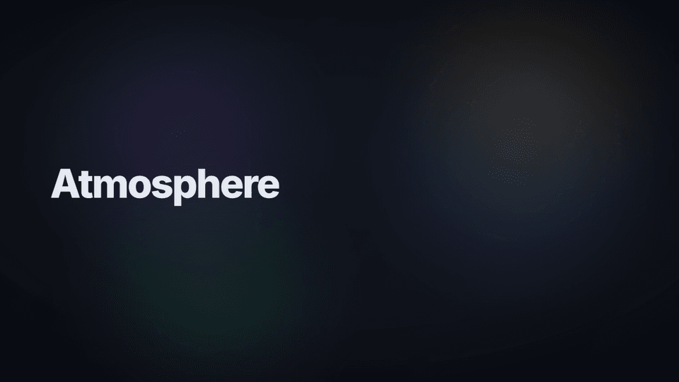 `Atmosphere` | 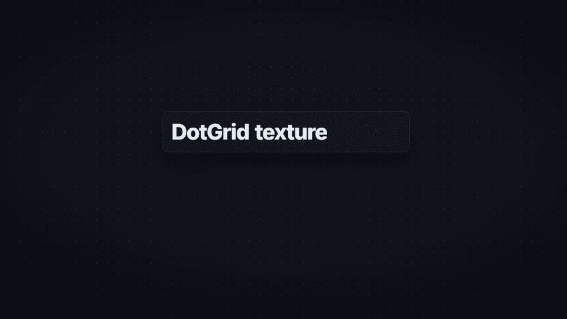 `DotGrid` |
| 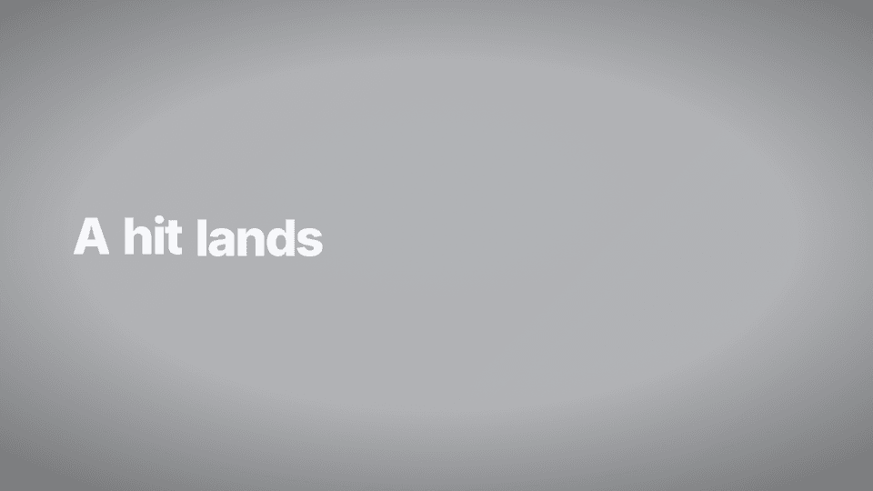 `Flash` |  `Letterbox` |
|  `Black` | |

`TransitionOverlay`, one still per type, a few frames into the cut (a blue "before" scene turning into a dark "after" one;
the light leak is at its peak on the cut itself):

| | | |
|---|---|---|
| 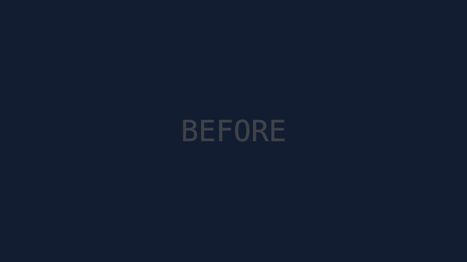 `fade` |  `whip` | 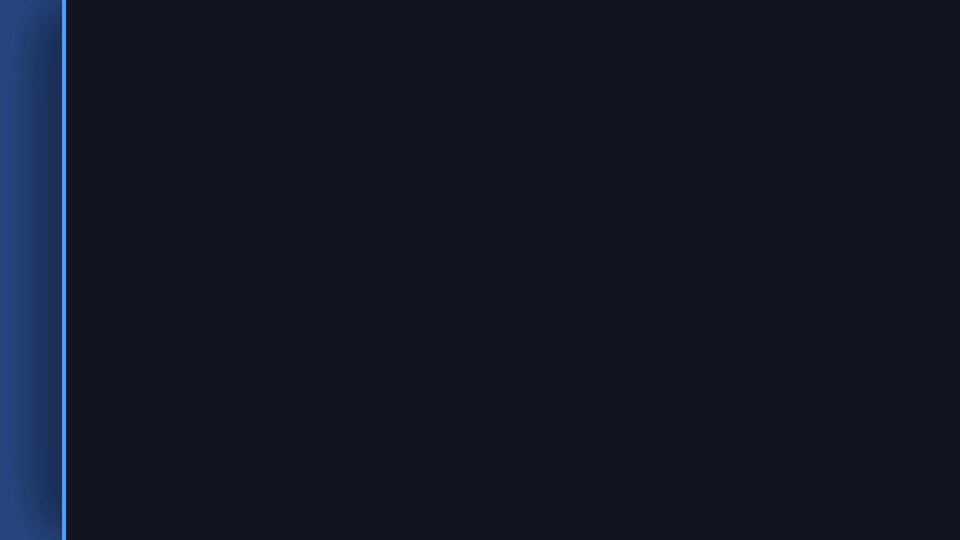 `push` |
| 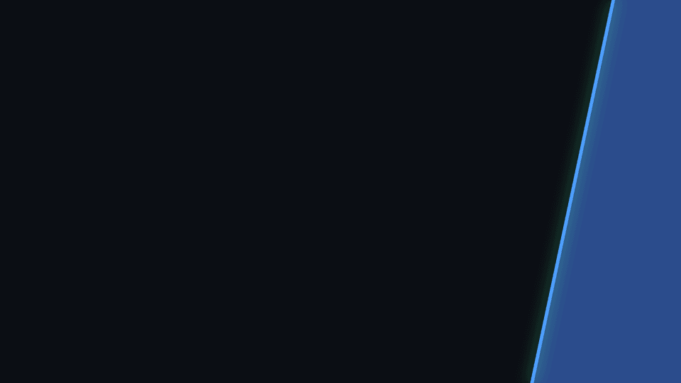 `wipe` | 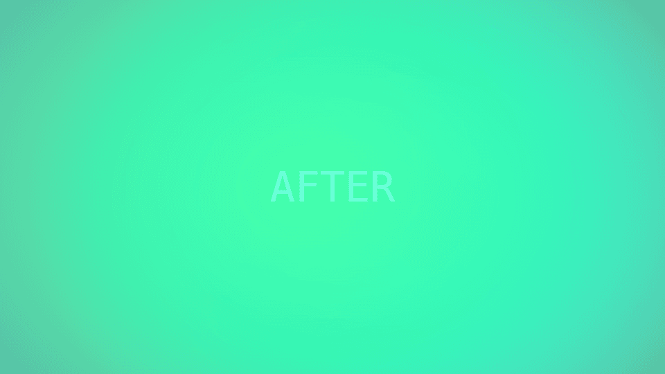 `light-leak` | |

---

## UI chrome

### `Window`

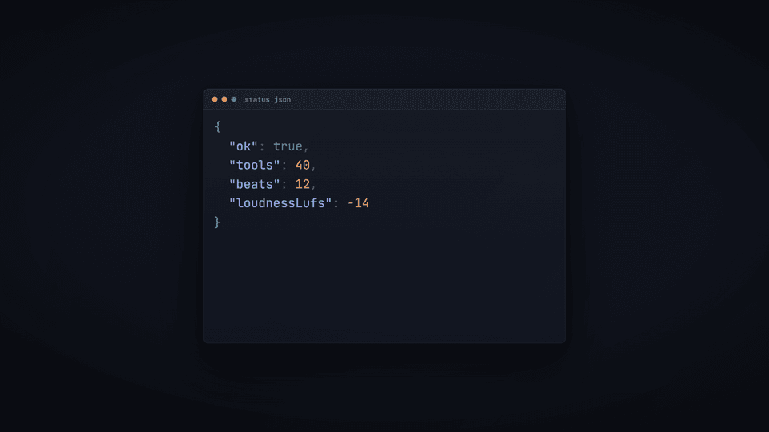

| Prop | Type | Default | Notes |
|---|---|---|---|
| `title` | `string` | | Omit for no title bar |
| `width` | `number` | required | |
| `height` | `number` | | |
| `light` | `boolean` | | Light chrome instead of the dark default, matches `BrowserFrame`'s light mode |
| `glow` | `string` | | Hex colour for an outer glow, when this window is the shot's focal point |
| `titleRight` | `ReactNode` | | |
| `children` | `ReactNode` | required | |

### `JsonView`

Syntax-coloured JSON of a real object, revealed line by line. An actually-rendered
view, not a screenshot of a JSON blob (the same ground-truth bias as `TerminalReplay`
being DOM text instead of a recorded terminal).

| Prop | Type | Default | Notes |
|---|---|---|---|
| `value` | `unknown` | required | `JSON.stringify(value, null, 2)`, line by line |
| `at` | `number` | `0` | |
| `perLine` | `number` | `1.2` | Frames between each line's reveal |
| `fontSize` | `number` | `20` | |
| `highlight` | `(line, i) => string \| undefined` | | Returns a hex accent to highlight a line with |
| `maxLines` | `number` | `400` | |
| `scroll` | `number` | `0` | |

### `Check`, `Cross`

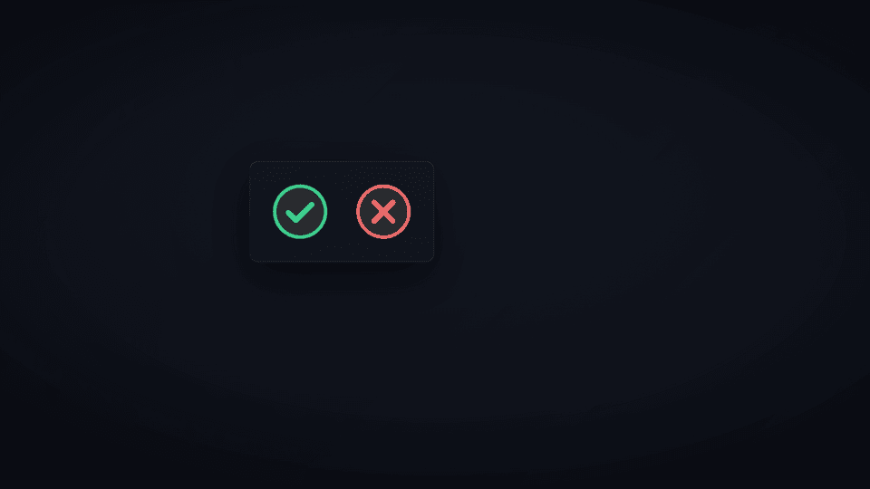

| Prop | Type | Default |
|---|---|---|
| `size` | `number` | required |
| `color` | `string` | `color.success` (`Check`) / `color.danger` (`Cross`) |
| `at` | `number` | `0`, `Check` only (draws its tick stroke in) |

### `ToolChip`

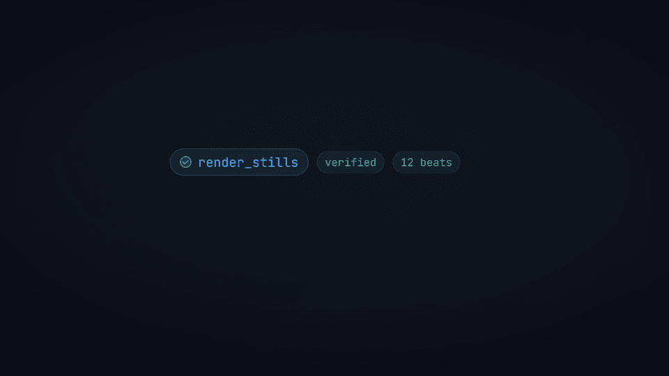

| Prop | Type | Default | Notes |
|---|---|---|---|
| `name` | `string` | required | |
| `at` | `number` | required | |
| `doneAt` | `number` | | Swaps the spinner for a `Check` once passed |
| `color` | `string` | `color.accent` | |
| `size` | `number` | `20` | |

"▸ tool_name" chip: spinner while running, a check once done.

### `Pill`

| Prop | Type | Default |
|---|---|---|
| `children` | `ReactNode` | required |
| `color` | `string` | `color.textSecondary` |
| `size` | `number` | `18` |
| `style` | `CSSProperties` | |

### `Glass`

| Prop | Type | Default |
|---|---|---|
| `children` | `ReactNode` | required |
| `style` | `CSSProperties` | |
| `pad` | `number` | `28` |

Frosted glass panel: `backdrop-filter: blur`, for a floating card over motion.

### `ChapterHud`

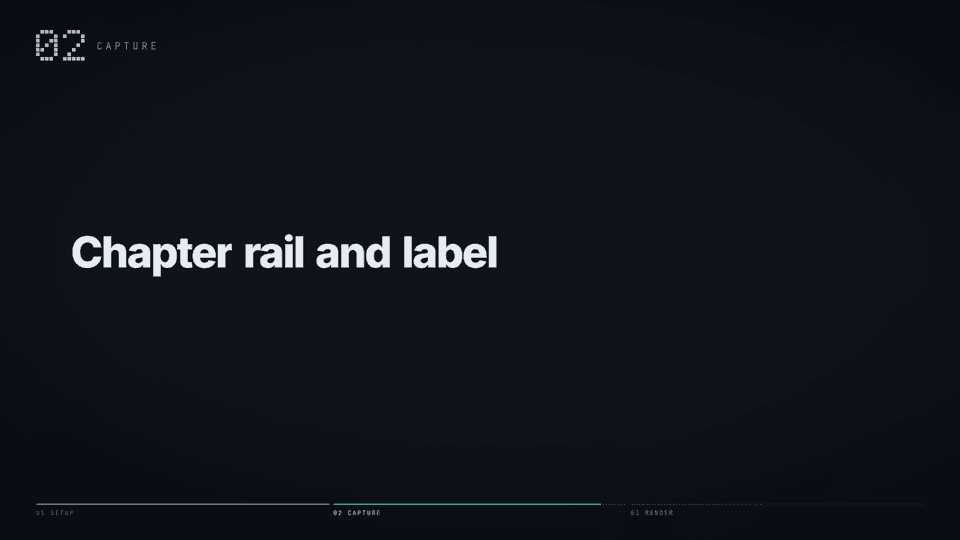

Screen space, meant for a scene's `overlay` (like `Caption`), not camera-transformed.
A dot-matrix chapter number and label top-left, a progress rail bottom.

| Prop | Type | Default | Notes |
|---|---|---|---|
| `chapters` | `Chapter[]` | required | `{ label: string }` |
| `activeIndex` | `number` | required | |
| `firstFrame` | `boolean` | `true` | True during this chapter's own opening stretch (plays the label-in and rail fill-in); false just holds the rail filled |
| `at` | `number` | `4` | |
| `fillDurationInFrames` | `number` | `90` | Pass the chapter's own duration so the fill lands exactly as it ends |
| `design` | `DesignSystem` | | Reads `grid.marginBottom` and palette from it when passed |
| `accentColor` | `string` | | Overrides `design`'s or the token success colour |

---

## A scene, end to end

```tsx
import React from "react";
import { CinematicScene, Layer, TerminalReplay, Caption, color, E } from "@openvidstudio/core";

export const Install: React.FC = () => (
  <CinematicScene
    camera={[
      { frame: 0, x: 960, y: 540, scale: 1.05, rotZ: -0.4 },
      { frame: 300, x: 960, y: 548, scale: 1.15, rotZ: 0.35, easing: E.drift },
    ]}
    overlay={<Caption text="one command" at={40} out={240} />}
  >
    <Layer depth={0}>
      <div style={{ position: "absolute", inset: 0, display: "flex",
                    alignItems: "center", justifyContent: "center" }}>
        <TerminalReplay
          width={1400}
          steps={[
            { type: "cmd", text: "node packages/mcp-server/dist/stdio.js" },
            { type: "out", lines: [{ text: "connected over stdio", color: color.success, glow: true }] },
          ]}
        />
      </div>
    </Layer>
  </CinematicScene>
);
```

Two keyframes so it moves, content centred inside the safe area, caption in the
overlay, tokens instead of hex.

---

## Catalog primitives

Small components that are not in `@openvidstudio/core` but are in the motion primitives catalog:
`catalog_motion_primitives` finds one and `add_motion_primitive` copies its source into the video's
`primitives/` folder, where it is yours to edit. Each imports only `react`, `remotion` and core.

### `CollageBroll`

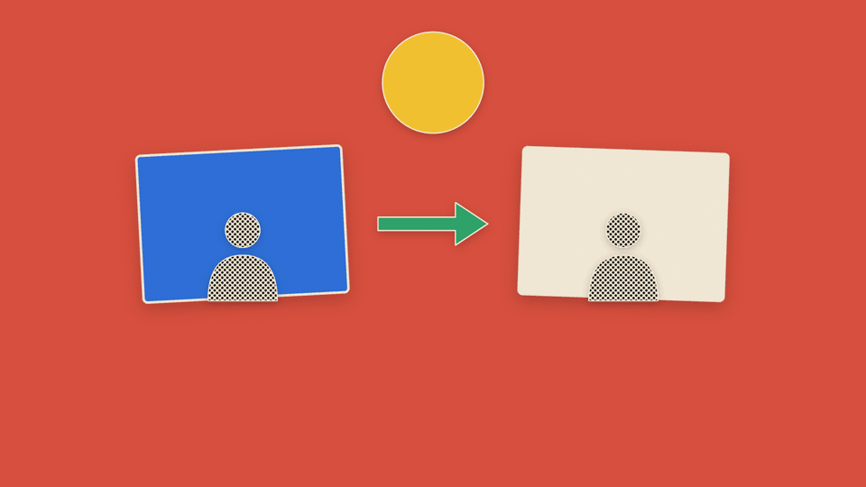

A halftone paper-collage b-roll beat for an abstract idea between screen captures, made in code: free, and
nothing in it is invented footage. A flat colour field, black and white halftone cut-outs, a few cardstock accents,
thin cream keylines, soft low-opacity shadows and fine paper grain. Pieces assemble structure first (structure,
then people or key cards, then connectors, then the result): each enters from empty space on a spring, in a set
order, with no fade and no zoom. It is inspired by the look of the MIT-licensed `gbro-collage-broll` skill, which
generates it with a paid model API; this is written from scratch and calls no model.

| Prop | Type | Default | Notes |
|---|---|---|---|
| `pieces` | `CollagePiece[]` | required | See below |
| `background` | `string` | `#D9503F` | The flat colour field |
| `order` | `("structure" \| "people" \| "connector" \| "result")[]` | that order | The order the roles arrive in; within a role, as listed |
| `at` | `number` | `0` | Composition frame the first piece starts to move. Before it the frame is the empty field |
| `stagger` | `number` | `10` | Frames between one piece starting and the next |

A piece is `{ src | shape, x, y, width, aspect?, rotation?, tone?, role? }`: `x`, `y` and `width` are fractions of the
frame (so it follows the frame size); `src` is an image (`staticFile(...)`) cut out in halftone; `shape` is
`"card"`, `"circle"`, `"person"` or `"arrow"`; `tone` is `"halftone"` (default), `"red"`, `"blue"`, `"yellow"`,
`"green"` or `"cream"`; `role` says when it arrives (default `"structure"`).

## Supernova: `@openvidstudio/stem`

The primitives for STEM lesson videos (production mode `"supernova"`, 1080x1920). A project made
with `init_project` `mode: "supernova"` can import them; a standard project cannot. Everything here is
a pure function of the frame, takes its sizes from `useVideoConfig()` and uses no random numbers.
Stills are 540x960, rendered for real by `scripts/build-api-gallery.mjs`.

```tsx
import { Spark, Nova, supernovaDesignSystem } from "@openvidstudio/stem";
```

### `supernovaDesignSystem(subject)`

The Void + Spark design system for one subject (`"math" | "physics" | "cs" | "chemistry" | "biology"`):
a flat dark Void (`#07060B`, panels `#0E0C16`, hairline at 5% white), warm white text (`#F3EFE6`, never
pure white, dim `#8C8799`), one accent per subject (math `#5CC8FF`, physics `#FFB347` with ember
`#FF7A3D`, cs `#B58CFF`, chemistry `#FF4D5E`, biology `#7CFFB2`), the `"void-spark"` motif, and a layout
grid that keeps key content clear of the Reels interface (108 / 270 / 420). `design.display` is the
display face, Space Grotesk; the body face is Inter. Both load from local files.

### `Spark`

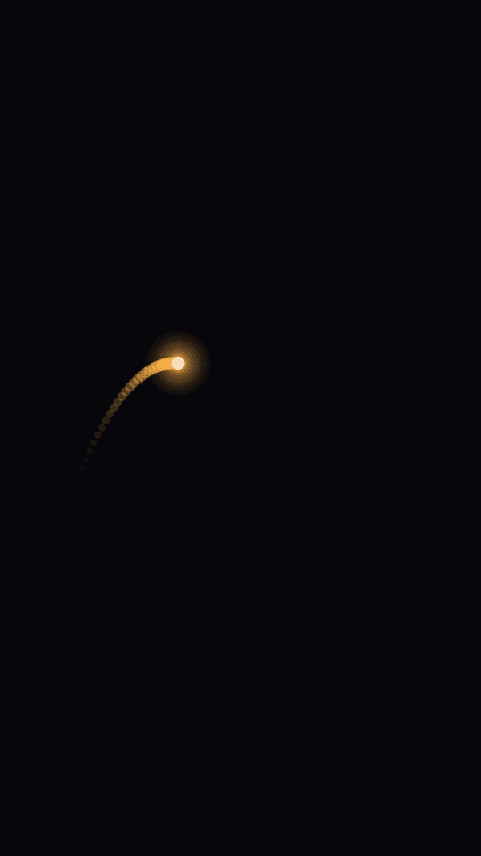

A luminous point: a bright core, a soft bloom and a fading trail. The pen, the pointer and the particle
of a lesson, with one on screen at a time.

| Prop | Type | Default | Notes |
|---|---|---|---|
| `path` | `Path \| Keyframe[]` | required | `(t) => ({ x, y })` with `t` in frames since `at`, or keyframes `{ frame, x, y, easing? }` (held at the ends, eased between) |
| `at` | `number` | `0` | Composition frame it appears. Nothing is drawn before it |
| `trail` | `number` | `18` | Frames of tail. Brighter near the head |
| `color` | `string` | the subject's accent | |
| `subject` | `Subject` | `"math"` | Picks the default colour |
| `size` | `number` | 1.4% of the shorter side | Radius of the core, px |

Behaviours are helpers that return a `Path`, so they compose: `trace(curve | points, { duration })`,
`carry(fn, from, to, { duration, map? })` (the Spark rides `y = fn(x)`; `map` is a graph-to-screen
mapping), `orbit(target, radius, { period })`, `split(parent, n, { at, spread })` (n paths),
`fall(g, { x, y, vx, vy }, { floorY? })` and `walk(points, { hop, hold })`.

### `Nova`

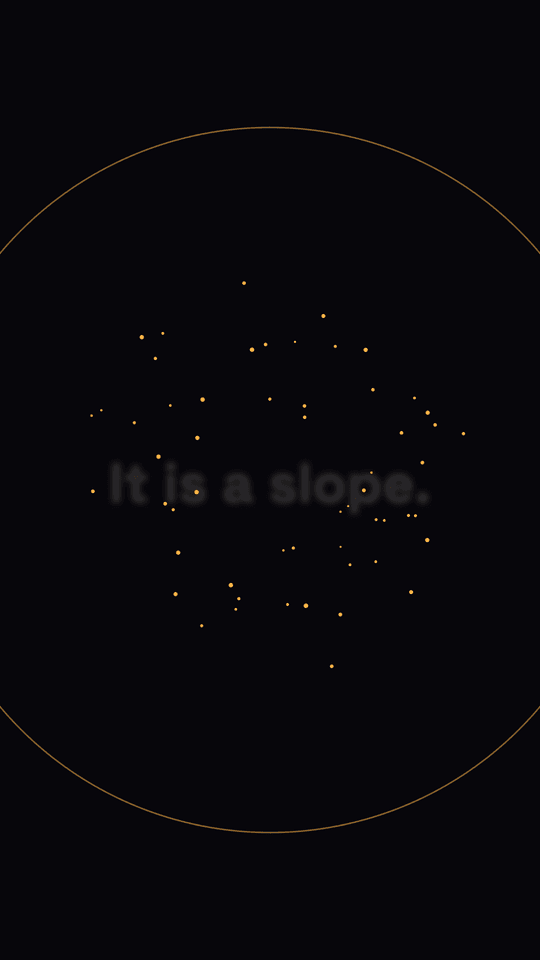

The payoff, once per video, on the aha sentence. Nothing before `at`; then a three-frame flash, a thin
shockwave ring that decelerates and fades, and the `children` condense from particles. Leave a beat of
silence in the narration before it.

| Prop | Type | Default | Notes |
|---|---|---|---|
| `at` | `number` | | Composition frame of the flash. Or: |
| `beatId`, `impact` | `string` | | Take the frame from `useMusicClock(beatId).impact(impact)`, the score's named impact |
| `origin` | `{ x, y }` | frame centre | |
| `color`, `subject` | | the subject's accent | |
| `duration` | `number` | `60` | Frames from the flash until the content is fully formed |
| `children` | node | | The payoff. Fully formed by `at + duration` |

### `Equation`

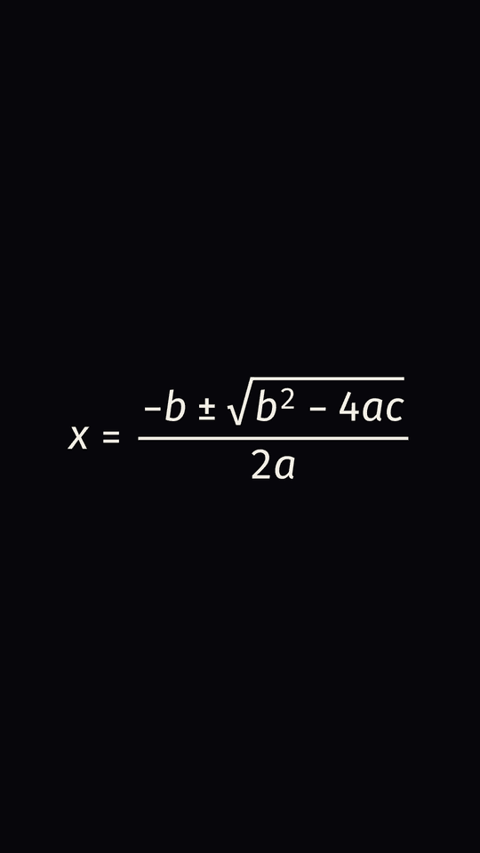

An equation typeset in sans-serif maths and revealed term by term: each top-level term fades in and rises
a little, one after the next, as a pure function of the frame (never a fade of the whole thing).

| Prop | Type | Default | Notes |
|---|---|---|---|
| `tex` | `string` | required | The equation as TeX |
| `spoken` | `string` | **required** | The equation as it is said, in plain words: "x squared plus one". Required by the types (and at runtime), and exposed on the element as `data-spoken`, so `check_script` can compare it with the narration of the beat |
| `at` | `number` | `0` | Composition frame the first term appears |
| `stagger` | `number` | `7` | Frames between one term and the next |
| `size` | `number` | 8.5% of the shorter side | Font size in px |
| `color` | `string` | the Void's warm white | |
| `center` | `{ x, y }` | frame centre | |

Terms are the children of the equation's top-level row, so `\frac{d}{dx}\left(x^{2}+1\right)=2x` reveals as
the fraction, `(`, `x²`, `+`, `1`, `)`, `=`, `2`, `x`. A fully revealed equation is pixel for pixel the same as
the unrevealed one. `texToSvg(tex)` gives the SVG markup directly.

**Why MathJax 4 with the Fira font, not KaTeX.** The visible goal is sans-serif maths, which is the biggest
break from the usual serif look. Measured on the same three equations at 1080 wide (MathJax and Fira first,
then KaTeX with `\mathsf`, the closest it gets):

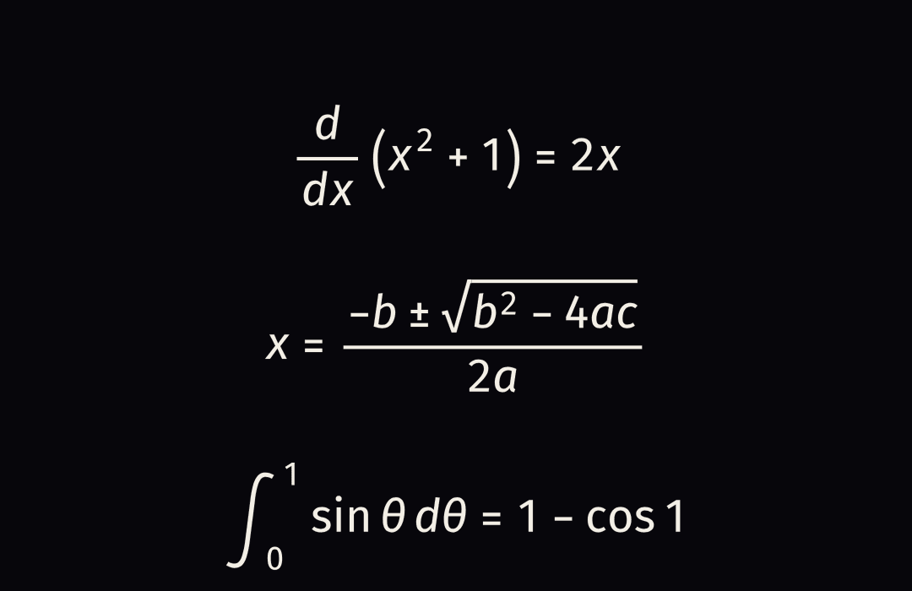

| | MathJax 4 + Fira (SVG) | KaTeX 0.19 |
|---|---|---|
| Look | Sans throughout: math italics, Greek, `sin` and `cos` in one family | Hybrid: `\mathsf` makes Latin letters upright sans, but `sin`, `cos`, `theta` and every operator stay serif, and variables lose their italics |
| Offline | Runs from the project's `public/mathjax/` (copied by `init_project`), no font files, glyphs are vector paths | Needs its CSS and about six font files shipped and loaded |
| Size | about 1.3MB of scripts, plus 2.2MB of Fira glyph ranges loaded on demand | about 360KB |
| Time | 3 equations typeset in about 140ms after a one-off start-up of about 0.5s | 3 equations in 6ms |
| Determinism | Same TeX, same markup, so a frame is a pure function of the frame | Same |

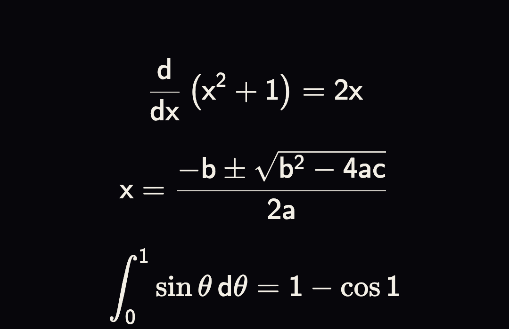

MathJax costs more to load and to typeset, once per document, and that is paid for a look that KaTeX cannot
produce. Its speech and braille workers are switched off (they would fetch 800KB of rule files).

### `Axes`, `Plot`, `NumberLine`

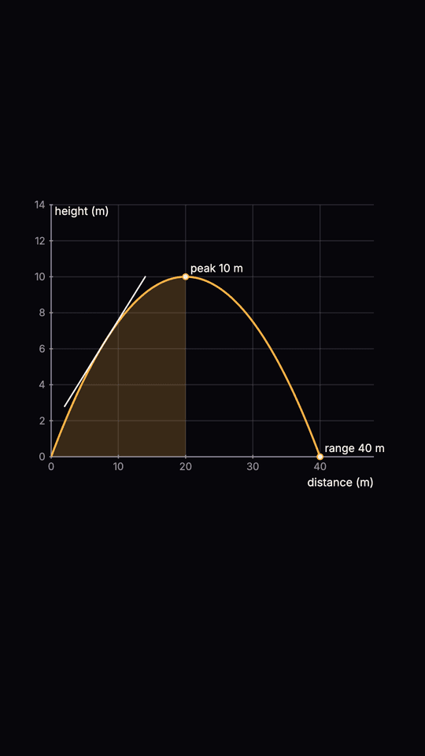

`Axes` draws labelled axes with ticks and owns the graph-to-screen mapping. Its children are placed in
graph coordinates: `useAxes()` returns `{ toScreen(x, y), toWorld(px, py), box, xRange, yRange, weight }`,
so a `Plot`, a label or a Spark's path (`carry(fn, a, b, { duration, map: toScreen })`) can use it.

| `Axes` prop | Type | Default | Notes |
|---|---|---|---|
| `xRange`, `yRange` | `[min, max]` | required | Graph units |
| `box` | `{ x, y, width, height }` | sized to the frame | The plot area, composition px |
| `xStep`, `yStep` | `number` | a round step, about five ticks | |
| `xLabel`, `yLabel` | `string` | | |
| `grid` | `boolean` | `true` | Gridlines at the ticks in the dim token, fainter than the axes |
| `subject` | `Subject` | `"math"` | Picks the accent children use |

| `Plot` prop | Type | Default | Notes |
|---|---|---|---|
| `fn` | `(x) => number` | required | A value that is not finite breaks the line |
| `domain` | `[a, b]` | the axes' x range | |
| `samples` | `number` | `240` | Across the domain |
| `progress` | `0..1` | `1` | How much is drawn. Or `at` and `duration` for a draw-on that eases from 0 to 1 |
| `color` | `string` | the accent | |
| `tangent` | `{ at, span?, color? }` | | A tangent at x, once the curve has reached it. `span` is its half-length in x units |
| `area` | `{ from, to, color? }` | | Shades between the curve and the x axis, as far as the curve has been drawn |
| `points` | `{ x, label? }[]` | | Dots on the curve, appearing as it reaches them |

`NumberLine` takes `range`, `step`, `points` (`{ value, label? }`), `intervals` (`{ from, to, openFrom?,
openTo? }`, open ends are hollow) and `arrow` (`{ value, label? }`), plus an optional `box` (`{ x, y,
width }`). `useNumberLine().toScreen(value)` lets a Spark ride the line.

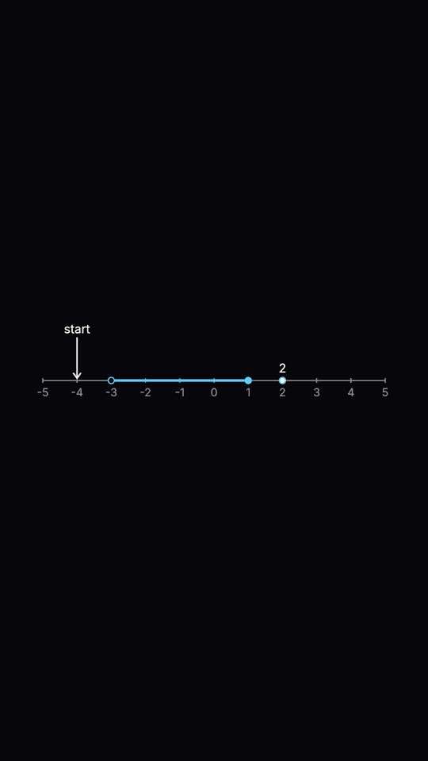

Strokes are never thinner than `lineWeight(width, height)`, 3px at 1080 on the shorter side (the plot
line is about 1.7 times that). None of these glow: the Spark is the one element that does.

### `Derivation`

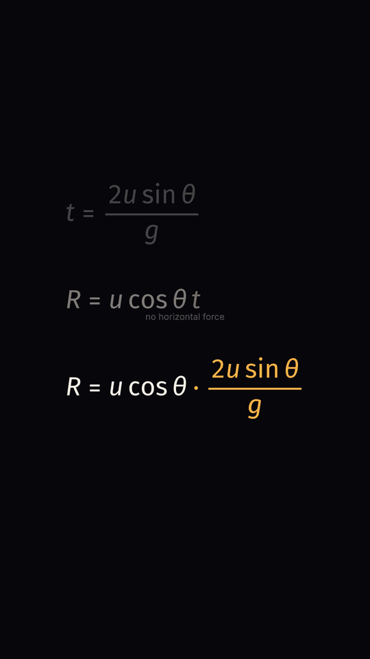

A formula built line by line, each line spoken: the derive beat of a lesson. The newest line sits at the bottom;
the one before it moves up and dims, up to a stack of three, so the viewer reads the algebra top to bottom. The
lines share a left edge and sit on a baseline, as algebra on paper does, so between two lines the terms they
share (matched by their TeX, top level terms) stay exactly where they are, and slide only if the terms before them
changed width. Terms that are new fade in and rise in the accent and settle to white; terms that are gone fade out where
they were. Term level, not per glyph. The range of a projectile, `R = u^2 sin(2 theta) / g`, in seven steps, is the sample scene.

| Prop | Type | Default | Notes |
|---|---|---|---|
| `steps` | `{ tex, spoken, because? }[]` | required | `tex` is the line. `spoken` is **required**, exactly as on `Equation`: it must appear in the beat's narration, in the order the steps are given, and `check_script` fails a step that does not. `because` is a short reason in plain words ("no horizontal force") shown under the step |
| `beatId` | `string` | | Reveal each step at the word its `spoken` starts at, found in `useNarrationWords(beatId)` after the previous step's words |
| `at` | `number[]` | | Explicit frames, one per step, which win over the narration |
| `from`, `stagger` | `number` | `0`, `60` | When there is neither narration nor `at`: the first step's frame and the gap between steps |
| `size` | `number` | 7% of the shorter side, smaller if the widest line would not fit | Font size in px |
| `color`, `subject` | | the Void's warm white, `"math"` | `subject` picks the colour new terms arrive in |
| `center` | `{ x, y }` | the horizontal centre, 60% down a tall frame | `y` is the baseline of the current line, `x` the middle of the block |

The stack is three lines: opacity 1, about a half, about a quarter; a fourth line is gone. `revealFrames`,
`matchTerms` and `slotOpacity` are the pure functions behind it.

### `LessonCaptions`

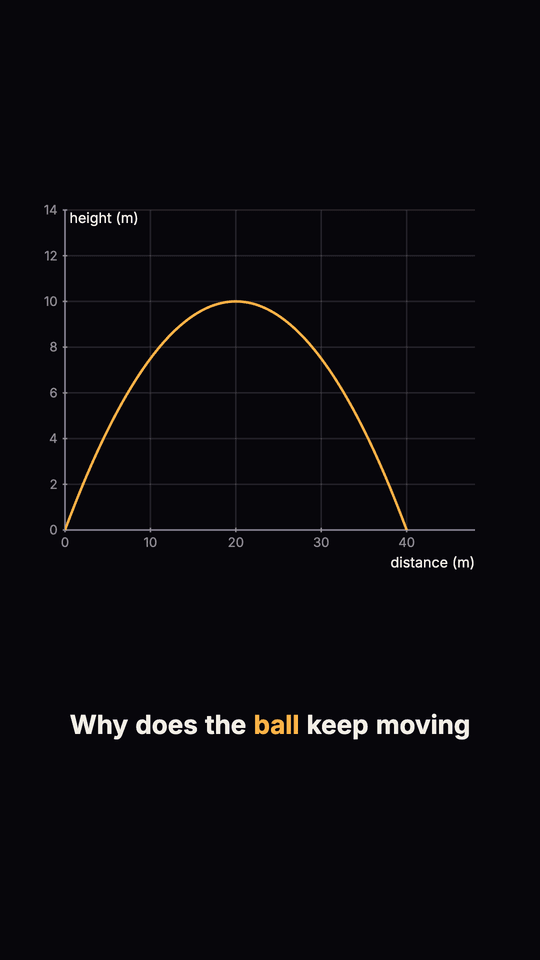

Burned-in captions timed to the narration, in one line: `<LessonCaptions beatId="hook" text={vo} />`. The word
timings (`<beat>.words.json`) carry bare words with no punctuation, so chunking on them runs one sentence into
the next. The text comes from the beat's `vo`: split on spaces, and when that gives as many words as the timings it is
shown with its punctuation, otherwise the timings' bare words are. A caption breaks at a sentence end, at a comma
after at least three words, and at `maxWords`; a one word sentence is a caption on its own. The word being said is
picked out in the subject's accent. A pure function of the frame.

| Prop | Type | Default | Notes |
|---|---|---|---|
| `beatId` | `string` | required | Read with `useNarrationWords(beatId)` |
| `text` | `string` | required | The beat's `vo` |
| `position` | `"bottom" \| "top"` | `"bottom"` | Above the bottom 22% or below the top 14% of a tall frame (8% either way on a wide one) |
| `maxWords` | `number` | `6` | Most words in one caption |
| `left`, `width` | `number` | 10% of the width, the rest | The block's box |
| `subject`, `fontSize` | | `"math"`, 4.8% of the shorter side | |

With no timings at all (an engine that gives none) the words are spread evenly over the scene, and the block says so in
`data-ovs-captions-timing="estimated"`. The block is tagged `data-ovs-captions`, which `validate_scenes` ignores when it
looks for the first drawn element and for a static stretch. `captionChunks(words, maxWords)` and `captionInsets(width, height)`
are the pure functions.

### `FreeBody`

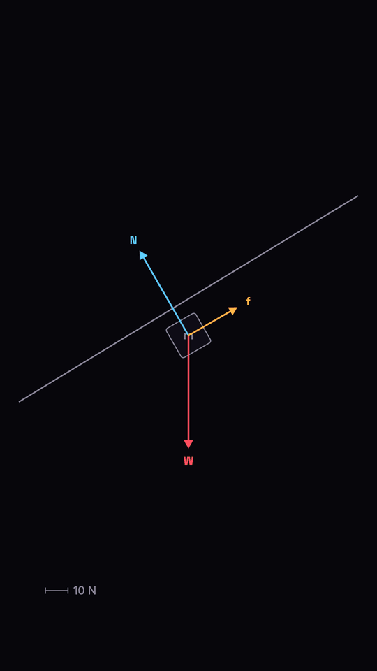

An object with labelled force arrows, for a physics lesson. The picture is honest: every arrow is exactly
`magnitude * scale` px from tail to tip and a scale bar says how much that is, so two forces compared by
eye are compared correctly. Arrows arrive one at a time. A block on a slope at rest (three forces that sum
to zero) is the sample scene.

| Prop | Type | Default | Notes |
|---|---|---|---|
| `forces` | `{ label, magnitude, angle, color? }[]` | required | `angle` in degrees counter-clockwise from the right (0 right, 90 up, 270 down) |
| `scale` | `number` | required | Pixels per unit of magnitude |
| `unit`, `scaleValue` | `string`, `number` | `"N"`, a round value near half the largest force | The scale bar's unit and the length it stands for |
| `scaleAt` | `{ x, y }` | lower left | Left end of the scale bar |
| `origin` | `{ x, y }` | frame centre | Where the object is; arrows start at its centre |
| `objectSize`, `objectRotation`, `objectLabel` | | 9% of the shorter side, 0, none | Rotation in degrees clockwise: -30 puts a block flat on a 30 degree slope that rises to the right |
| `at`, `stagger`, `order` | | `0`, `18`, as given | When the first arrow starts, frames between arrows, and the order as indices into `forces` |
| `net` | `boolean` | `false` | Also draw the net force as a dashed arrow once the others are in. Left out when the net is zero |

### `ArrayViz`

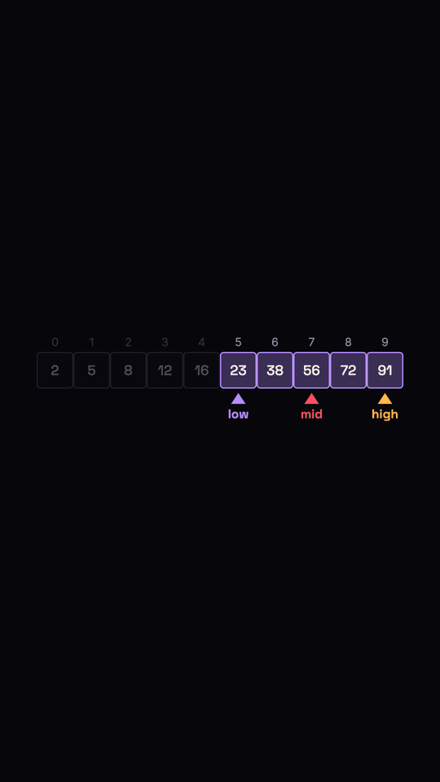

A row of cells holding values, with named pointers, a highlighted range and a dimmed one: enough to teach
binary search and a sorting pass. Binary search over a sorted array is the sample scene.

| Prop | Type | Default | Notes |
|---|---|---|---|
| `values` | `(number \| string)[]` | required | One cell each, numbered above |
| `pointers` | `{ name, index, color?, spark? }[]` | | `index` is a cell, or keyframes `{ frame, index }` that move the pointer (eased, fractional between cells). With `spark: true` the pointer's tip is the Spark, so its move leaves a trail. At most one pointer may (one glowing element at a time) |
| `highlights` | `{ from, to, color? }[]` | | Cells to fill with the accent, inclusive: the range still in play |
| `dimmed` | `{ from, to }[]` | | Cells ruled out, inclusive |
| `origin`, `cellSize` | | centred, fits 84% of the width | |
| `subject` | `Subject` | `"cs"` | Picks the accent |

`useArrayViz()` returns `{ cellSize, left, top, cellCenter(i) }` so a Spark's path (`walk`) can be built from
the cells' own positions.

### The glow budget

One glowing element at a time. Spark and Nova draw their glow through `Glow`, which tags its element
with `data-ovs-glow` and `data-ovs-glow-level`; `countGlowing(root)` counts the elements above
`GLOW_VISIBLE_LEVEL`. A Spark is one, a Nova's flash is one (the ring and particles do not glow).
